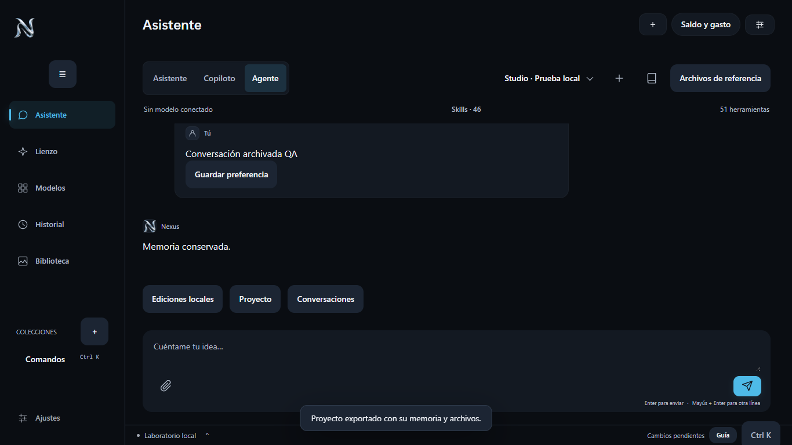
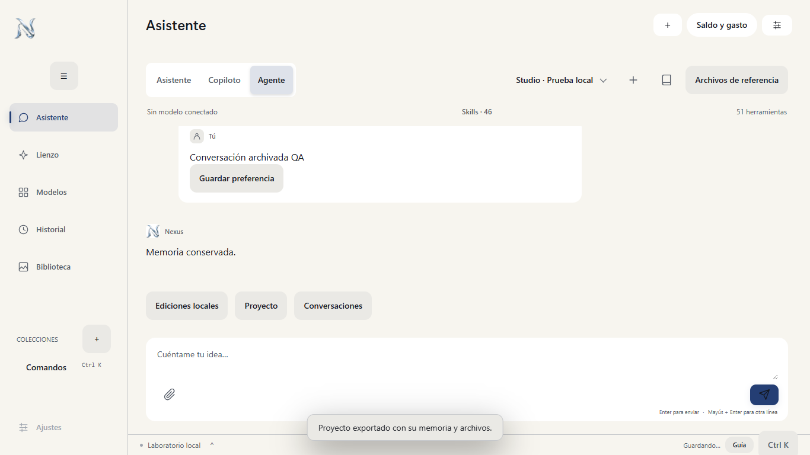

# Nexus Studio Windows: incorporación de Nexus Agent 1.9.2

La edición del EliteBook incorpora el núcleo y las 50 herramientas de la APK comprobada en el Samsung S25, **1.9.2-agent-preview, versionCode 36**. Conserva además `get_model_brief`, herramienta propia de Windows: **51 herramientas disponibles**. Fuente Android `fbae847eee709ae462b7e5eb83fa8b47ccad3ad8`, worktree `nexus-agent-media-tools`, rama `codex/aki-attachments-20261011`. La rama de esta adaptación es `codex/desktop-agent-parity-20261011`.

Se partió de esa fuente Android y se incorporó la edición Windows que realmente estaba funcionando, incluidos sus cambios previos de Flow, catálogo, lotes y recuperación. Se conservaron esos trabajos en su carpeta original. El manifiesto de procedencia del núcleo está en `desktop/agent/android-source-manifest.json`; las diferencias específicas de Windows son el adaptador JVM, las operaciones nativas y el selector de Sol. No se modificó la app del teléfono.

## Funciones incorporadas

| Área | Disponible en Windows | Comprobación |
|---|---|---|
| Agente | Mismo toolkit, skills, instrucciones, planes, contexto, presupuestos, razonamiento firmado y CountTokens; hasta 32.000 tokens y 7 rondas | 126 pruebas del núcleo + 15 del adaptador experto; turno real de Sol usando `get_nexus_settings` |
| Conexiones | Sol con la cuenta y el puente existentes del S25; Bedrock directo y otros proxies siguen disponibles | Sol real; disponibilidad de cada modelo Bedrock no probada con operaciones facturables |
| Adjuntos | Imágenes reales, PDF/documentos binarios y seis fotogramas de vídeo; indexación y referencias por proyecto | Sol identificó el fondo rojo de una imagen, «LUNA 73» de un PDF y el azul del vídeo; sin lectura de audio directa |
| Proyectos | Selector, creación, memoria completa, personajes, notas, referencias, selección y borrado lógico, ZIP con archivos | Pruebas de nota, exportación ZIP, documento y conservación del archivo original |
| Conversaciones | Archivado al crear/abrir otra conversación, restauración de texto y adjuntos, planes históricos consultables y reutilizables en el lienzo | Restauración real desde la interfaz; no se reejecutan los pagos históricos |
| Internet y MCP | Buscar, leer, conectar/desconectar, descubrir con paginación y ejecutar herramientas de consulta | Transporte JSON/SSE, sesión, paginación e `isError` probados con un servidor local; consultas externas individuales no todas probadas |
| Operaciones de Nexus | Ajustes, saldos Atlas, estado de encargos, recuperación del seguimiento, diagnóstico y reparación de Flow | Herramientas presentes; reparación sobre una sesión Google real no ejecutada en esta entrega |
| Edición local | Recortar, unir tamaños/fps distintos, eliminar/sustituir/mezclar audio, extraer WAV y fotogramas, renombrar y convertir imágenes | 8 pruebas con FFmpeg y archivos reales; recorte y publicación del resultado desde la interfaz |
| Whisper | Base multilingüe descargado, SHA verificado, ejecución local, TXT/SRT | Transcripción real del ejemplo público JFK; ambos archivos creados y contenido comprobado |
| Cola de edición | Persistente, serial, resultados con linaje, consulta de estado; reinicio marca interrupción sin reenviar | Prueba de recuperación tras fallo e interrupción; dos hilos de CPU, límite de 15 minutos en Whisper |
| Catálogo y creación | Catálogo Windows completo, formularios, referencias, costes, presets, comparación, lotes y funciones Flow existentes | 842 entradas base; se incorporaron los cuatro IDs nuevos del snapshot Android. Los alias Kling nativos se conservan. No se generó con cada modelo |
| Biblioteca y visor | Galería progresiva, filtros, favoritos, colecciones, documentos TXT/SRT, editor desde el visor, descarga y Alexia en S25 | Navegación y documento probados; Alexia resuelta por ADB, apertura no forzada durante QA |
| Estética | Aurora, OLED, Quartz, Océano, Bosque y Claro; jerarquía 24/17/16/14/12, superficies calmadas, saldo compacto, hojas completas | 108 comprobaciones: seis temas × tres escalas × seis pantallas; revisión de capturas |
| Accesibilidad y PC | Foco visible, controles de 48 px, fuente 100/130/150 %, teclado y avisos de finalización | Sin desbordamiento horizontal ni errores JS en la matriz. Avisos requieren habilitarlos en Edge; no se certifica auditoría completa con lector de pantalla |
| Ajustes | Modelo, región, proxy, claves propias consultables/editables, moneda, fuente, temas, herramientas y diagnóstico | Configuración trasladada y verificada; la región no se reemplazó por una supuesta |

## Perfil e instalación

La migración agregó **186 registros de generaciones** al historial Windows y conservó sus 107 entradas, dando **293**. Se copiaron **54 archivos locales** y **13 conversaciones**, sin borrar los originales. Los resultados HTTPS permanecen en su URL; una edición descarga el archivo cuando se solicita. Las claves del teléfono se escribieron en el almacén del usuario de Windows y se comprobó su lectura sin sustituir cuentas.

La comprobación de la instalación confirmó **2 proyectos, 353 activos indexados**, 51 herramientas, Sol configurado y Whisper listo. Las cantidades son una fotografía de esta migración; el S25 continúa creando contenido y no se ha implementado sincronización continua bidireccional.

El programa instalado vive bajo `%LOCALAPPDATA%/Programs/NexusStudio/1.9.2-<hash>/Nexus-Studio/desktop`. Los accesos del Escritorio y `Documents/Biblioteca/Aplicaciones/Nexus Studio.lnk` apuntan allí. Los datos permanecen en `%LOCALAPPDATA%/NexusDesktop`. Se utiliza el Python firmado y Edge ya instalados; no depende de mantener abierto el worktree de Codex. Los backups y capturas del perfil real se conservan en outputs privados.

Sol reutiliza el puente autenticado del móvil mediante SSH sobre Tailscale: Windows `127.0.0.1:18787` → S25 `127.0.0.1:8787`. Por ello **el S25 debe estar disponible para Sol**. La edición, Whisper, biblioteca y proyectos se procesan en el EliteBook. No se migró el puente AKI ni se creó otra cuenta de Sol en Windows.

## Validación y límites

- Compilación JVM en ASUS, prioridad baja, un worker, sin paralelismo: **PASS**.
- **141 pruebas JVM, 8 de edición/MCP, 9 de integridad del host y 7 de Flow: PASS**.
- **108 comprobaciones de interfaz: PASS**, con escalas 1.0, 1.3 y 1.5.
- Recorte desde UI → cola → archivo → índice/biblioteca; exportación ZIP; visor SRT; conversación archivada; comparación A/B y reutilización de planes de sesiones anteriores: **PASS**.
- Sol real con herramienta y adjuntos imagen/PDF/vídeo: **PASS**.
- Whisper real local, TXT/SRT: **PASS**.
- Perfil y accesos de la instalación real: **PASS**.
- No se realizaron generaciones multimedia de pago, ni subidas de archivos a proveedores. No se afirma que cada modelo, una generación Flow completa, TalkBack/lector de pantalla o cada servidor MCP externo hayan sido probados.

Los ejemplos de UI publicados son sintéticos. Las pruebas y la migración contienen un corte de datos, no equivalen a compartir automáticamente futuros cambios del S25.

## Capturas de prueba

Reproducción: `desktop/tools/build-agent-asus.py`, `test-native-parity.py`, `test-host-integrity.py`, `test-flow-provider.py`, `test-desktop-agent-parity-ui.py`, `test-desktop-parity-functional.py --sol`, `verify-desktop-parity-installed.py`. `package-desktop-parity.py` genera el ZIP sin perfiles privados. Las herramientas históricas `package-agent.py`/`migrate.py` documentan la migración de octubre anterior y no sustituyen este flujo.
