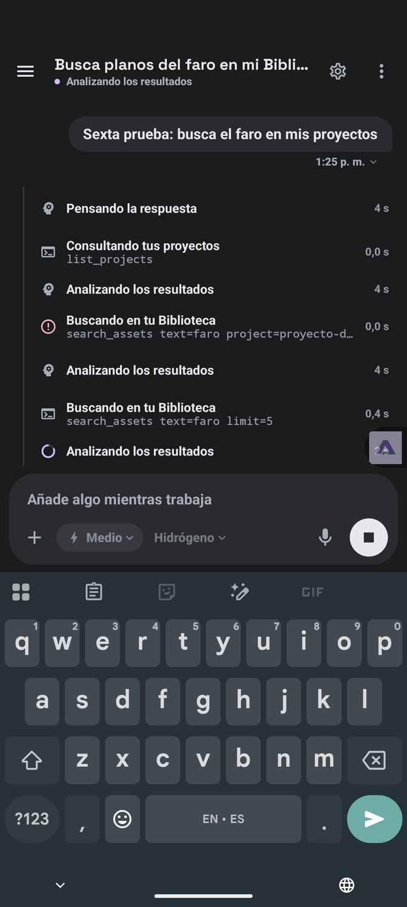
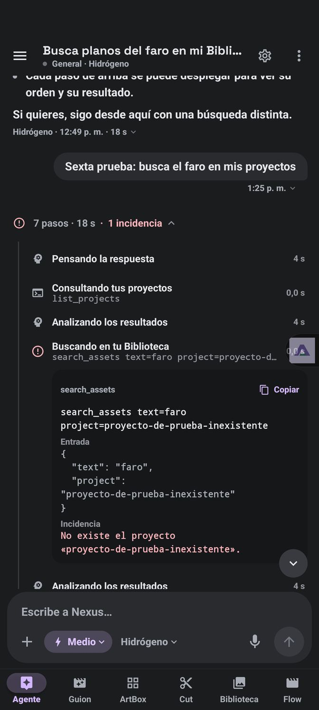
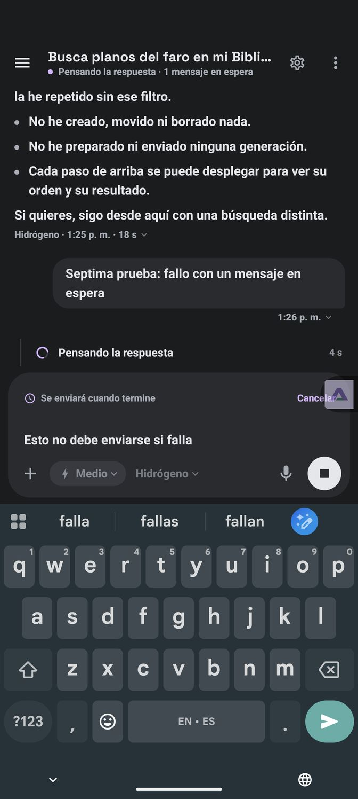
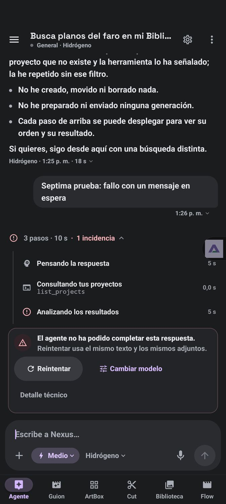
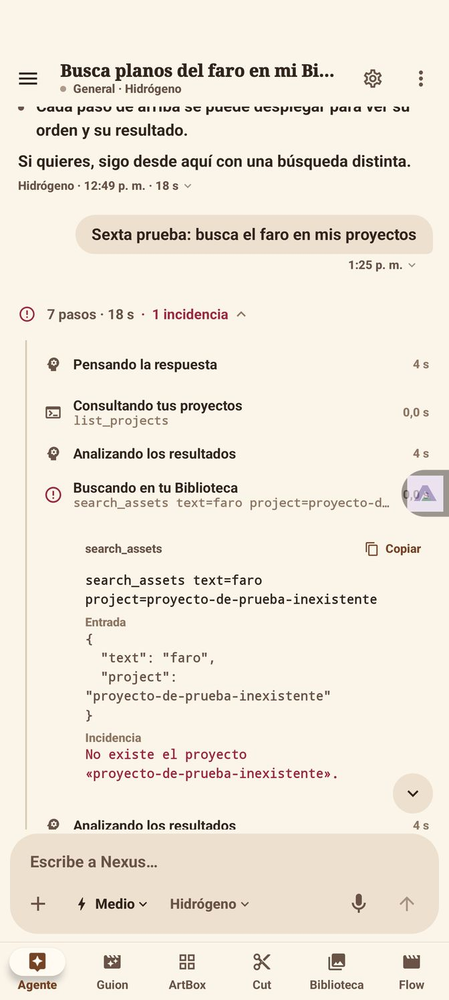

# Rediseño de la pantalla del Agente — vc224 / 1.9.188-agent — 18/11/2026

Encargo de Vidal: rehacer la composición de la pantalla del Agente tomando como referencia otra APK suya
(cabecera compacta, actividad del agente dentro de la conversación, mensajes planos, compositor de un bloque,
acabado carbón y mate). Rama `aki/agent-redesign-20261118` sobre `aki/cut-premium-20261117` (`72207c98`, vc221).

## Estado

| Qué | Estado |
| --- | --- |
| Compilado | AWS CodeBuild `vidal-android-build:419391f5-784e-4f85-bcea-f662bc3a6de8` SUCCEEDED sobre `3ab2340a` |
| Pruebas JVM | agent-core 544 (4 omitidas), app 194, cut-core 133; 0 fallos, 0 errores |
| Firmado | identidad instalada (cert `8b75db0f…7127`), v2+v3, 16 KiB, 6/6 `.so` idénticas a vc220 |
| APK | `Nexus-Agent-1.9.188-agent-preview-vc224-preview.apk`, SHA-256 `3e98171d10c655cec10d8e20fbce81b4173f1a82b43f5ef4afca07835b735371` (test-only: instalar con `-t`) |
| APK instalable | `Nexus-Agent-1.9.188-agent-preview-vc224-instalable.apk`, SHA-256 `257ac2601285635e3f48fa175a814959d77f97b1364c976d7a509547bf0c846e`. CodeBuild `vidal-android-build:adeecf0b-1cc6-482d-b281-02c5abf1b611` SUCCEEDED sobre `5b55394e` con `-Pandroid.injected.testOnly=false`, sin pruebas; misma firma y versionCode 224. El código de la app es el de `3ab2340a` (entre los dos commits solo cambian documentos); frente a la APK de arriba cambian el manifiesto (sin la marca test-only, así que se instala tocándola), la cadena de revisión y la fecha. No se ha instalado ni probado en ningún dispositivo desde este trabajo. |
| Release | Prerelease `v1.9.188-agent` en GitHub (https://github.com/egodivergente/nexus/releases/tag/v1.9.188-agent), publicada el 19/11 con el visto bueno de Vidal: etiqueta sobre `5b55394e`, la APK instalable como `NEXUS-Agent-1.9.188-vc224-5b55394.apk` y `SHA256SUMS.txt`. Descarga pública comprobada contra el SHA-256. |
| Instalado | **Instalada en el Pixel 8 Pro** (18/11 a las 14:50:24, `adb install -r -t` sobre la primera compilación de la misma vc224; 4258 archivos de datos antes y después, 0 desaparecidos, archivos de Cut idénticos, misma firma). Desde el 18/11 a las 23:35 el Pixel lleva encima la vc225 de AXEL Link (ver la fila del S25), puesta por ese hilo. |
| S25 | Lleva la **vc225** `1.9.189-agent-preview` de AXEL Link (rama `aki/axel-link-agent-20261118`, commit `589d960a`, SHA-256 `8176db142ea1c5f55d12bf9e7d4bc5d6e0dfd98224442525daa7dedbbe0d8c9b`), que es esta rama entera (`5b55394e`) más cuatro commits de AXEL Link. Esos commits no tocan la interfaz de la pantalla del Agente (`AssistantScreen.kt` y los demás archivos de composición son idénticos); en la app solo añaden las herramientas remotas en `AssistantRuntime.kt`, un método de depuración en `NexusAgentProvider.kt` y `NexusLink.kt`. La instaló el hilo de AXEL Link el 19/11 a las 01:39:12 con `adb install -r -t --user 0` sobre la vc220 (5073 archivos de datos antes y después, según su registro). Comprobado desde este trabajo por adb, en solo lectura: versionCode, SHA-256 de la APK instalada, firma y fecha de primera instalación conservada (entró como actualización). La vc224 como tal no llegó a instalarse en el S25: el 18/11 el teléfono había salido de la wifi de casa y la copia previa de datos se cortó. No se ha abierto ni probado en él. |
| Probado en dispositivo | Pixel 8 Pro: a mano con un guion local sin modelo (la pantalla, con la vc222; los avisos, con la vc224) y dos turnos con modelo real (AGY, Hidrógeno): uno sin herramientas sobre la APK final y otro con cinco llamadas a herramientas sobre la vc225, que contiene esta rama; pruebas instrumentadas 6/6 sobre `926698f7`, no repetidas sobre el código final (ver «Pruebas»). |

## Qué cambia

### 1. Cabecera compacta (`AgentChatHeader`, `agentHeaderStatus` en `assistant/AgentActivity.kt`)

- El título de la conversación es el elemento principal (una línea, `titleMedium` seminegrita). Al tocarlo se abre
  el cambio de proyecto, como antes hacía el nombre del proyecto.
- Debajo, el estado real del agente con un punto de 6 dp. El punto solo toma el acento cuando hay algo en marcha.
  El texto sale del estado de la app, en este orden: paso en curso del turno («Buscando en tu Biblioteca»,
  «Pensando la respuesta»…, más «· 1 mensaje en espera» si hay cola), «Preparando adjuntos», «Resumiendo el
  contexto», «Trabajando en otra conversación», «N encargos en curso» y, en reposo, «proyecto · modelo».
- Se conservan el menú de conversaciones (izquierda), los ajustes y el menú de opciones (derecha).
- El selector de modelo sale de la cabecera y pasa al compositor.

### 2. Actividad integrada en la conversación (`AgentActivityLive`, `AgentActivitySaved`)

- El orquestador emite un evento nuevo, `UiEvent.Step`, por cada paso real del turno: cada espera al modelo
  (`THINK`) y cada herramienta (`TOOL`). Se anuncia al empezar y se vuelve a emitir con el mismo `id` al acabar,
  con su duración. No hay pasos de adorno: si el turno no hace nada, no hay línea.
- Cada fila: icono a la izquierda sobre una línea vertical fina, frase corta en el centro y duración a la derecha
  («0,4 s», «8 s», «1 min 4 s»). Estados: en curso (acento y cronómetro vivo), completado (gris), con incidencia
  (círculo de exclamación en el color de error del tema) y cancelado.
- Si el paso tiene detalle (comando de una línea, entrada, resultado o incidencia), la fila se despliega y lo
  enseña en monoespaciado, con ajuste de línea y un botón «Copiar». Antes de guardarse, el detalle pasa por el
  redactor de registros y, encima, por `AgentSteps.scrub`: se ocultan los valores de los campos con nombre de
  credencial (`password`, `secret`, `token`, `api_key`, `authorization`, `cookie`…) y las formas conocidas
  (`Bearer …`, `sk-…`, `ghp_…`, `AIza…`, `xox…`, JWT). Se recorta a 2000 caracteres por campo.
- Al terminar el turno la actividad se pliega en una línea («7 pasos · 36 s · 1 incidencia») encima de la
  respuesta; un toque la abre.
- Se guarda con la conversación (`ChatItem.Assistant.steps`, `ChatItem.Notice.steps`; como mucho 60 pasos por
  respuesta), así que al reabrir la conversación la actividad sigue ahí. Los pasos que quedaran en curso al
  parar o fallar se cierran como cancelados o con incidencia: una conversación guardada nunca aparece
  «trabajando».
- Conversaciones anteriores: solo guardaban los nombres de las herramientas; se enseñan como pasos completados
  sin duración.
- Las frases de las herramientas habituales están en `toolActivity` (agent-core). Una herramienta nueva sin frase
  se lee «Usando …» con su nombre.

### 3. Mensajes

- Respuesta del agente: sin tarjeta, sobre el fondo, con el ancho de lectura de antes y aire entre párrafos.
- Mensaje del usuario: alineado a la derecha, fondo un tono por encima del de la pantalla, sin contorno.
- Tarjetas de generación (`OrderCard`): planas, mismas partes que antes, con el estado y la acción disponible en
  la propia tarjeta.
- «Recuperar»: cuando el seguimiento de un encargo se pausó pero el proveedor llegó a aceptarlo (hay
  identificador de trabajo), la tarjeta dice «Seguimiento pausado» y ofrece «Recuperar», que consulta ese mismo
  trabajo (`AssistantViewModel.recoverOrder`). No envía ni cobra otro.

### 4. Compositor de un bloque (`InputBar` en `assistant/AssistantExperience.kt`)

- Un solo panel redondeado: arriba el campo; debajo, adjuntos («+»; pulsación larga, archivos recientes), la
  píldora de modo, la píldora de modelo, el micrófono y la acción principal.
- En reposo el botón principal envía y solo toma el acento cuando hay algo que enviar.
- Durante la ejecución el campo sigue abierto con «Añade algo mientras trabaja» y el botón de detener está
  siempre visible. Lo que se escriba se puede dejar en cola («Enviar al terminar»): aparece «Se enviará cuando
  termine» con «Cancelar», sigue siendo editable y sale solo cuando acaba la respuesta. Nexus no admite inyectar
  texto en un turno ya en marcha; por eso es una cola y no una interrupción.
- La cola nunca se pierde en silencio (`QueuedSend.afterTurn`): solo se envía si la respuesta acabó por sí misma
  en la conversación que está en pantalla. Si el turno falla, se agota el tiempo o el agente cambia de proyecto,
  el mensaje sigue como borrador y Nexus lo dice. Si se detiene la respuesta, el borrador se queda en el campo.
  Un envío con tablero que falla después de vaciar el campo devuelve el texto al borrador.
- El borrador y los adjuntos se conservan al pasar de reposo a ejecución y al volver.
- Píldora de modo: Nexus solo tiene el modo Agente, así que la píldora controla lo que sí cambia el
  comportamiento, el nivel de razonamiento.
- Píldora de modelo: con los cerebros que admiten cambiar de modelo desde el chat (AGY y Codex) abre la lista;
  con el resto abre los ajustes del asistente, donde se elige.

### 5. Acabado (`AgentChatTheme`, `AgentChatColors`)

- Con un tema oscuro, la pantalla del Agente y la barra de pestañas usan fondo carbón (`#1B1C1E`) y superficies
  mates escalonadas; el acento del tema elegido queda para el estado activo y la acción principal. Los temas
  claros conservan su papel.
- Menos contornos y brillos; controles de 36 a 42 dp de dibujo con zona táctil de 48 dp. La línea plegada de la
  actividad y las filas que despliegan detalle también ocupan 48 dp de alto; las filas sin detalle se quedan
  más juntas.
- El compositor sube con el teclado y la conversación se recoloca; con el teclado abierto se ocultan las
  pestañas.

### 6. Avisos al pie de la conversación (vc224)

- Los avisos emergentes (un turno que falla, la cola que no se envió, un borrador de memoria conservado) vivían en
  el hueco de avisos de la pantalla y flotaban sobre el compositor: tapaban el campo y la fila de controles justo
  cuando hacía falta detener o reintentar. Ahora salen dentro del área de la conversación, pegados a su borde
  inferior, encima del compositor.
- La lista cede al final el alto del aviso, así que el aviso tampoco tapa el último mensaje; una conversación que
  estaba al final sigue al final. El hueco se abre y se cierra animado, y el botón «Bajar al final» sube con él.
- Los avisos con acción («Reintentar», «Seguir editando») siguen a la vista hasta que se cierran, como antes;
  mientras están, ocupan ese sitio de la zona de lectura.

## De paso

- `Redactor`: uno de sus patrones (token suelto de 40 caracteres) no tiene grupo de captura y leer el grupo 1
  lanzaba una excepción a quien estuviera redactando. Corregido, con prueba. El detalle de los pasos pasa por él.
- `ChatMarkdown`: un elemento de lista que empezaba por un punto suelto («- · Kling Pro») se pintaba con doble
  viñeta. Corregido, con prueba.

## Compatibilidad

- `AssistantChatStore` lee con `ignoreUnknownKeys`: una versión anterior abre las conversaciones nuevas e ignora
  `steps`. Probado en `AgentChatCompatibilityTest`.
- La sincronización por Drive solo copia `role` y `text` de cada mensaje: `steps` no viaja y no afecta a la
  vc220 del S25 ni a Windows.
- Sin cambios en trabajos, adjuntos, proyectos ni en la firma.

## Capturas (Pixel 8 Pro; tema Nocturne salvo donde se indica)

En reposo: título y estado en la cabecera, actividad plegada en una línea, respuesta plana, compositor de un bloque.

Durante una ejecución: el estado de la cabecera es el paso en curso, las filas llevan icono, frase y duración, el campo dice «Añade algo mientras trabaja» y el botón principal es detener.

Paso con incidencia: la fila se despliega y enseña la orden, la entrada y lo que devolvió la herramienta.

Mensaje en espera: «Se enviará cuando termine» con «Cancelar»; la cabecera lo cuenta.

Turno que falla: la actividad queda con su incidencia y la tarjeta ofrece Reintentar y Cambiar modelo.

Con un tema claro (Champagne Silk) la composición es la misma y el fondo sigue siendo el del tema.

vc224: el aviso de un turno fallido sale al pie de la conversación, encima del compositor; la tarjeta del fallo queda entera por encima y el campo y los controles, libres.

El Pixel tiene activado el texto en negrita del sistema (`font_weight_adjustment=300`): en las capturas la
letra sale más gruesa que en un teléfono sin ese ajuste.

## Pruebas

- JVM nuevas: `AgentStepsTest` (9), `CodecRedactorTest` (+1), `ChatMarkdownTest` (+1), `OrderBookTest` (+3),
  `AgentActivityTextTest` (8), `AgentChatCompatibilityTest` (5), `AgentChatThemeTest` (4), `OrderCardLogicTest` (12),
  `QueuedSendTest` (8).
- Instrumentadas nuevas: `AgentChatRedesignUiTest` (6): cabecera en reposo y en ejecución, fila con incidencia y su
  detalle, actividad guardada plegada, compositor en ejecución con cola y detener, tarjeta con «Recuperar».
  Ejecutadas en el Pixel 8 Pro el 18/11 a las 12:42 sobre `926698f7`, en un sandbox aparte (`com.vidadomu.nexus.minimalqa`, instalado y desinstalado; Nexus sin cambios): `OK (6 tests)`. **No se repitieron sobre el código final**: el APK de pruebas de `d593ec9f` compila (CodeBuild `7eba9c73-8e56-4324-b153-68d3d9efde8b`), pero a esa hora otro agente estaba usando el Pixel y la instrumentación le habría cortado su servicio de accesibilidad. Entre `926698f7` y el código final cambian las frases de las herramientas, el ajuste de línea del detalle y el alto de 48 dp de las filas; las dos comprobaciones de alto añadidas en `d593ec9f` no se han visto pasar en un dispositivo. En la vc224 cambia además la colocación de los avisos (`AssistantScreen.kt`), que estas pruebas no cubren.
- En el Pixel, a mano con un guion local: con la vc222 (`7678bd91`; desde entonces el código de la app solo cambia en los avisos): reposo, borrador con el teclado, ejecución completa (7 pasos, uno con incidencia devuelta por la herramienta real), actividad guardada plegada y desplegada, detalle de la incidencia, cola «Enviar al terminar» (el mensaje en espera salió solo al acabar), detener a mitad (paso cerrado como cancelado), error del modelo (tarjeta con Reintentar y Cambiar modelo) y error del modelo con un mensaje en espera (no se envió, siguió en el campo y Nexus avisó); la cola que se envía sola y detener, con la primera compilación de la vc222 (`bb9f68f7`). Con la vc224, los avisos: con el teclado abierto y un mensaje en espera, un turno que falla (primera compilación, `14ecc111`) deja los dos avisos encima del compositor sin tapar el campo ni los controles; con el teclado cerrado (APK final) el aviso queda al pie, la tarjeta del fallo entera por encima, la lista sube animada y, al cerrar el aviso, baja sin dejar hueco. Sin cierres inesperados.
- Turno con un modelo real: dos, autorizados por Vidal, de solo lectura, con el cerebro AGY, modelo Hidrógeno (`gemini-4-hydrogen-medium`), razonamiento «Medio».
  - **Sin herramientas** (18/11 a las 15:08, Pixel, APK final vc224): «Lista mis proyectos y dime cuantos hay». Respondió bien en 20 s, sin error ni cierre. La cabecera pasó a «Pensando la respuesta», el campo a «Añade algo mientras trabaja» con el botón de detener, y al acabar la actividad quedó plegada («1 paso · 20 s») y la lista siguió el final. El modelo contestó sin llamar a ninguna herramienta (un solo paso de pensar).
  - **Con herramientas** (19/11 a las 17:51, Pixel, sobre la vc225 de AXEL Link, que contiene esta rama; la vc224 ya no estaba instalada): se le pidió buscar en la Biblioteca las imágenes más recientes de un proyecto y consultar el historial de generaciones, sin generar nada. 9 pasos en 55 s: 4 esperas al modelo y 5 llamadas a herramientas (`search_assets` dos veces, `get_generation_history` dos veces, `list_library_assets`). La cabecera fue enseñando el paso en curso, las filas entraron una a una con su orden resumida y su duración, la lista siguió el final, la respuesta llegó como texto que va entrando (alrededor de 1 s) y al acabar la actividad quedó plegada («9 pasos · 55 s»). Sin errores en el registro de la app ni cierres; ninguna herramienta devolvió una incidencia. El modelo dio los tres nombres y dijo que no podía dar el total del historial porque la consulta no devuelve un contador: es cosa de la herramienta, no de la pantalla. Este turno enseñó tres detalles, sin cambiar (ver «Pendiente y límites»): el texto «Tarda más de lo normal» a los 30 s, un parpadeo al acabar y los asteriscos de una negrita sin cerrar mientras llega el texto.
  - Las capturas y los vídeos de los dos turnos no van al repositorio: enseñan nombres de proyectos y de archivos de Vidal.

### Guion local sin modelo (`assistant/AgentChatQa.kt`)

Solo en compilaciones depurables (`BuildConfig.DEBUG`) y solo por adb, a través del puente de depuración que ya
existía (`content call … --method agent_chat_qa`). Arma el siguiente turno para que lo responda un guion local
en vez de un modelo. El guion pasa por el mismo bucle del agente: llama a herramientas reales de solo lectura
(`list_projects`, `search_assets`) y hace una búsqueda sobre un proyecto que no existe, de modo que es la propia
herramienta la que devuelve la incidencia. El escenario `model_error` hace fallar la segunda llamada al modelo
(exceso de solicitudes). No sale ninguna llamada externa ni se gasta nada.

## Revisión independiente

Un segundo agente, solo con lectura, repasó el diff contra los cinco puntos del encargo. Sin hallazgos graves.
Lo que señaló y qué se hizo:

| Hallazgo | Gravedad | Qué se hizo |
| --- | --- | --- |
| El redactor de secretos era estrecho para un detalle que ahora se guarda con el chat | media | `AgentSteps.scrub` y campos sospechosos ocultos; prueba nueva |
| El mensaje en cola podía perderse si un envío con tablero fallaba después, y la cola se descartaba sin avisar | media | `QueuedSend`, aviso y vuelta al borrador; `QueuedSendTest` |
| La cola no tenía pruebas | media | `QueuedSendTest` (8) |
| Filas clicables por debajo de 48 dp | media | 48 dp en la línea plegada y en las filas con detalle |
| El orquestador solo cierra el paso de pensar en los errores que conoce | baja | sin cambiar: el ViewModel cierra lo que quede abierto al acabar el turno |
| `recoverOrder` no hace nada si la conversación trabaja en segundo plano | baja | sin cambiar |
| El guion de pruebas armado no caduca solo | baja | sin cambiar: solo existe en compilaciones depurables y se desarma con `clear` |

Confirmó además que «Recuperar» no reenvía ni cobra, que el guion de pruebas no es alcanzable en una
compilación de publicación y que las funciones previas del chat se conservan.

Los arreglos pasaron después una segunda revisión de solo lectura: sin hallazgos graves ni medios. Menores, sin
cambiar: en texto libre (no en el JSON de la entrada, donde el campo se oculta entero) una contraseña solo
numérica o de menos de 6 caracteres seguiría visible, y a cambio se oculta algún texto inocuo como
`token_type=Bearer`; si un envío en cola se niega con una nota en la conversación, puede salir además el aviso
de la cola.

El cambio de los avisos (vc224) pasó otras dos revisiones de solo lectura. La primera, sobre `14ecc111`: 9 de 9 puntos conformes; señaló que la lista daba un salto al aparecer y al desaparecer el aviso y que el alto medido podía quedarse viejo, y las dos cosas se corrigieron en `3ab2340a`. La segunda, sobre `3ab2340a`: 8 conformes y 1 con reserva. Dejó dos riesgos teóricos de gravedad media, sin cambiar: si el desplazamiento que hace sitio al aviso coincide con el que sigue a la respuesta, la lista podría dejar de seguir el final hasta que se toque «Bajar al final». No se ha reproducido en el Pixel, tampoco en el turno con modelo real. Menores, sin cambiar: si el dedo sujeta la lista cuando sale el aviso, la lista no se recoloca sola.

## Pendiente y límites

- **«Recuperar» con un encargo real**: probado en JVM (`OrderBookTest`, `OrderCardLogicTest`) y en la prueba instrumentada de la tarjeta; no con un trabajo real pausado.
- **S25**: lleva la vc225 de AXEL Link, que contiene esta rama, pero no se ha abierto ni probado en él (no se toca la pantalla de Vidal). Cut premium va dentro. Ni esta rama ni la vc225 llevan el arreglo del reintento de 5 h de la sincronización del guion (la vc220 que tenía tampoco).
- **Turno real con herramientas**: hecho el 19/11 sobre la vc225 (ver «Pruebas»). Con un modelo real sigue sin verse un paso con incidencia devuelta por una herramienta ni un turno de más de un minuto.
- **«Tarda más de lo normal»** (`AgentActivityLive`): sale cuando el turno entero lleva 30 s, aunque el agente siga avanzando paso a paso. En el turno real con herramientas estuvo a la vista desde el segundo 30 hasta el final (55 s) sin que nada fuera mal. Sin cambiar; lo razonable es medir el paso en curso, no el turno.
- **Parpadeo al acabar el turno**: el texto que ha ido llegando se quita de golpe y la respuesta guardada entra con la animación de fila nueva (`EntranceSpring`), así que lo que se estaba leyendo desaparece unos 70 a 100 ms y vuelve en otros 100 ms. Medido fotograma a fotograma en los vídeos de los dos turnos reales (vc224 y vc225). El mecanismo ya estaba en el commit base (`72207c98`), no lo introduce el rediseño; no se ha comprobado con un vídeo de la versión anterior. Sin cambiar.
- **Negrita sin cerrar**: mientras llega la respuesta, un `**` sin su pareja se ve tal cual hasta que llega el cierre (alrededor de 1 s en el turno real). Sin cambiar.
- **Instrumentadas**: pasaron sobre `926698f7` y no se han repetido sobre el código final (ver «Pruebas»).
- **Avisos con acción**: el de un turno fallido lleva «Reintentar» y se queda hasta que se cierra; mientras está, ocupa el pie de la zona de lectura (la lista le hace sitio).
- **Seguimiento del final con un aviso a la vista**: dos riesgos teóricos de la revisión, sin reproducir y sin cambiar (ver «Revisión independiente»).
- **Selector de modelo**: solo cambia de modelo en el sitio con AGY y Codex; con los demás cerebros abre los ajustes.
- **Tema claro**: conserva su fondo de papel; el carbón solo se aplica a los temas oscuros.
- Hallazgos menores de la revisión que no se han tocado: ver la tabla de arriba.
- En el Pixel queda la conversación de prueba «Busca planos del faro en mi Biblioteca» (proyecto General), con los turnos del guion local y el turno real. Nexus no tiene borrado de conversaciones; se sincroniza por Drive como texto.
