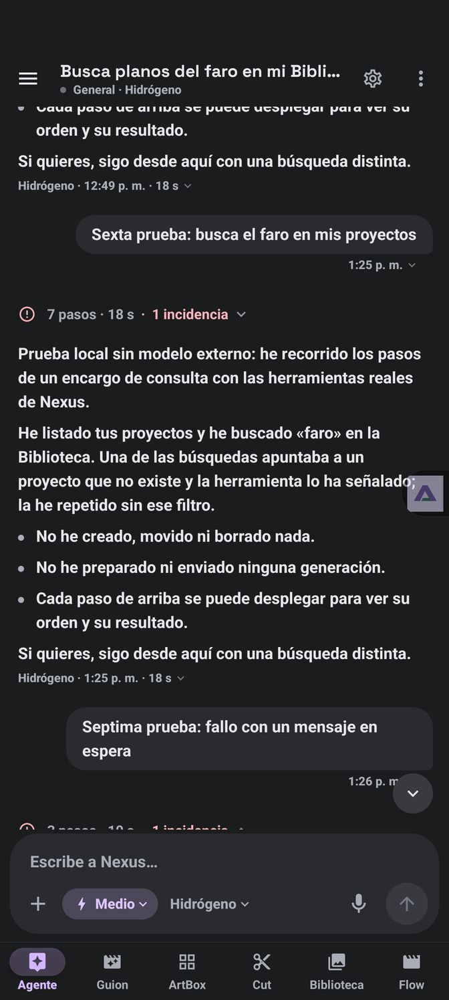
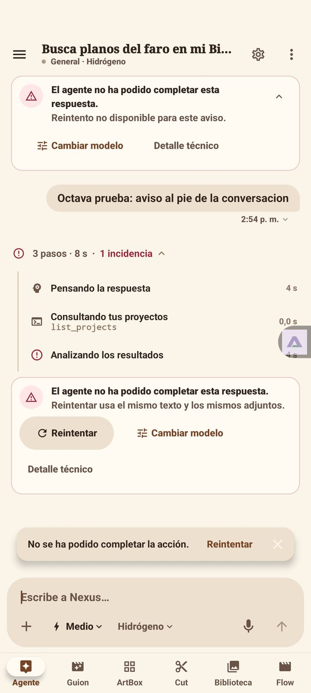

# Rediseño de la pantalla del Agente — vc224 / 1.9.188-agent — 18/11/2026

Encargo de Vidal: rehacer la composición de la pantalla del Agente tomando como referencia otra APK suya
(cabecera compacta, actividad del agente dentro de la conversación, mensajes planos, compositor de un bloque,
acabado carbón y mate). Rama `aki/agent-redesign-20261118` sobre `aki/cut-premium-20261117` (`72207c98`, vc221).

## Estado

| Qué | Estado |
| --- | --- |
| Compilado | AWS CodeBuild `vidal-android-build:419391f5-784e-4f85-bcea-f662bc3a6de8` SUCCEEDED sobre `3ab2340a` |
| Pruebas JVM | agent-core 544 (4 omitidas), app 194, cut-core 133; 0 fallos, 0 errores |
| Firmado | identidad instalada (cert `8b75db0f…7127`), v2+v3, 16 KiB, 6/6 `.so` idénticas a vc220 |
| APK | `Nexus-Agent-1.9.188-agent-preview-vc224-preview.apk`, SHA-256 `3e98171d10c655cec10d8e20fbce81b4173f1a82b43f5ef4afca07835b735371` (test-only: instalar con `-t`) |
| APK instalable | `Nexus-Agent-1.9.188-agent-preview-vc224-instalable.apk`, SHA-256 `257ac2601285635e3f48fa175a814959d77f97b1364c976d7a509547bf0c846e`. CodeBuild `vidal-android-build:adeecf0b-1cc6-482d-b281-02c5abf1b611` SUCCEEDED sobre `5b55394e` con `-Pandroid.injected.testOnly=false`, sin pruebas; misma firma y versionCode 224. El código de la app es el de `3ab2340a` (entre los dos commits solo cambian documentos); frente a la APK de arriba cambian el manifiesto (sin la marca test-only, así que se instala tocándola), la cadena de revisión y la fecha. No se ha instalado ni probado en ningún dispositivo desde este trabajo. |
| Release | Prerelease `v1.9.188-agent` en GitHub (https://github.com/egodivergente/nexus/releases/tag/v1.9.188-agent), publicada el 19/11 con el visto bueno de Vidal: etiqueta sobre `5b55394e`, la APK instalable como `NEXUS-Agent-1.9.188-vc224-5b55394.apk` y `SHA256SUMS.txt`. Descarga pública comprobada contra el SHA-256. |
| Instalado | **Instalada en el Pixel 8 Pro** (18/11 a las 14:50:24, `adb install -r -t` sobre la primera compilación de la misma vc224; 4258 archivos de datos antes y después, 0 desaparecidos, archivos de Cut idénticos, misma firma). Desde el 18/11 a las 23:35 el Pixel lleva encima la vc225 de AXEL Link (ver la fila del S25), puesta por ese hilo. |
| S25 | Lleva la **vc225** `1.9.189-agent-preview` de AXEL Link (rama `aki/axel-link-agent-20261118`, commit `589d960a`, SHA-256 `8176db142ea1c5f55d12bf9e7d4bc5d6e0dfd98224442525daa7dedbbe0d8c9b`), que es esta rama entera (`5b55394e`) más cuatro commits de AXEL Link. Esos commits no tocan la interfaz de la pantalla del Agente (`AssistantScreen.kt` y los demás archivos de composición son idénticos); en la app solo añaden las herramientas remotas en `AssistantRuntime.kt`, un método de depuración en `NexusAgentProvider.kt` y `NexusLink.kt`. La instaló el hilo de AXEL Link el 19/11 a las 01:39:12 con `adb install -r -t --user 0` sobre la vc220 (5073 archivos de datos antes y después, según su registro). Comprobado desde este trabajo por adb, en solo lectura: versionCode, SHA-256 de la APK instalada, firma y fecha de primera instalación conservada (entró como actualización). La vc224 como tal no llegó a instalarse en el S25: el 18/11 el teléfono había salido de la wifi de casa y la copia previa de datos se cortó. No se ha abierto ni probado en él. |
| Probado en dispositivo | Pixel 8 Pro: a mano con un guion local sin modelo (la pantalla, con la vc222; los avisos, con la vc224) y dos turnos con modelo real (AGY, Hidrógeno): uno sin herramientas sobre la APK final y otro con cinco llamadas a herramientas sobre la vc225, que contiene esta rama; pruebas instrumentadas 6/6 sobre `926698f7`, no repetidas sobre el código final (ver «Pruebas»). |

## Mejoras del 20/11 por la tarde: vc227 / 1.9.191-agent

Cinco mejoras de la pantalla del Agente, propuestas tras repasar la vc226 y encargadas por Vidal («Si. Adelante, haz
las 5 mejoras»), y un arreglo que salió al probarlas (punto 6). Rama `aki/agent-polish-20261120` sobre `aki/agent-fixes-20261120` (`73b3723e`, la vc226), sin mover
esa rama ni las anteriores, ni los PR #19 y #20. Commits: `b5de6e13` (pasos más limpios), `671040d6` (aviso de
lentitud), `17be4e8c` (un solo mensaje por fallo), `229a9c58` (final del turno), `ed9faa1c` (Markdown del núcleo de
escritorio) y `c630f955` (versión). Después, de las revisiones y de las pruebas: `0edd7750` (un turno que falla en otra conversación no se anuncia como terminado), `2032ab33` (el programa de escritorio vuelve a compilar), `b2ba71f6` (el hueco bajo la última fila) y `2c3edfaa` (ajustes de la segunda revisión).

| Qué | Estado |
| --- | --- |
| Compilado | AWS CodeBuild `vidal-android-build:bd0799ed-3699-47cc-84ca-ff3380911f26` SUCCEEDED sobre `2c3edfaa` |
| Pruebas JVM | agent-core 562 (4 omitidas), app 1055 (todas las de la app: 211 del paquete `assistant` y 844 del resto), cut-core 133; 0 fallos, 0 errores. Núcleo de escritorio: `ChatMarkdownTest` 28 de 28, en AXELPC. |
| Firmado | identidad instalada (cert `8b75db0f…7127`), v2+v3, 16 KiB, 6/6 `.so` idénticas a vc220 |
| APK | `Nexus-Agent-1.9.191-agent-preview-vc227-preview.apk`, SHA-256 `45f7cf4dd09b0df464ca0fcbed73751e644f4fadb7d5998513b8d873ad80a597`. Sin la marca test-only (se instala tocándola); `debuggable`. |
| Instalado | **Pixel 8 Pro**, 20/11 a las 19:16:48, `adb install -r` sobre la compilación anterior de la misma vc227. Hubo tres antes: `807775c7…ba35` (sobre `c630f955`, puesta a las 18:13:32 encima de la vc226 `2f1445f5…c917`; 4303 archivos de datos), `9a059f6a…ab21` (sobre `2032ab33`, a las 18:23:18; 4309) y `1db89131…8233` (sobre `b2ba71f6`, a las 19:01:44; 4326). En la final, 4337 archivos de datos antes y después, 0 desaparecidos, archivos de Cut idénticos, misma firma y fecha de primera instalación; lo mismo en las tres anteriores. |
| S25 | Sin tocar: sigue con la vc225. |
| Probado en dispositivo | Pixel 8 Pro: diez turnos con el guion local sin modelo, un turno con modelo real (AGY · Hidrógeno, solo lectura) y las pruebas instrumentadas, 7 de 7. Sobre la compilación final van tres de los diez turnos y el turno real; las instrumentadas, sobre `b2ba71f6`, un commit antes (ver «Pruebas de la vc227»). |
| Escritorio | Código y pruebas del núcleo, y `DesktopAgent.kt` vuelve a compilar (`compileKotlin` de `desktop/agent`, en AXELPC). **Sin compilar el instalador ni desplegar**; la edición de Windows en uso sale de otra rama (punto 4). |

### 1. Final del turno sin salto (`turnClosingRowId` en `assistant/AssistantScreen.kt`; `rememberTurnSettle`, `AgentActivitySaved` en `assistant/AgentActivity.kt`)

Al acabar un turno, la lista de pasos en vivo se cambiaba de golpe por la línea «7 pasos · 45 s»: todo lo de encima
bajaba de una vez y las filas llegaban después deslizándose (lo que quedó «a la vista» en la vc226).

- La fila que cierra el turno (la respuesta, o el aviso de un turno detenido o fallido) ocupa el sitio de la actividad
  en vivo con los mismos pasos a la vista y, desde ahí, se asienta en un solo movimiento de 260 ms: la línea de
  resumen se abre mientras los pasos se cierran bajo ella.
- La línea de autor y hora abre su propio hueco bajo el texto. Lo que la fila trae y no estaba en pantalla (una
  respuesta que no se transmitió, el aviso) aparece con una transición de opacidad.
- Mientras la fila se asienta, las demás se colocan en su sitio exacto, sin deslizarse detrás de cada cambio de
  altura, y una lista que estaba al final se mantiene al final en cada fotograma. Si el lector ha subido, no se le
  arrastra.
- Todos los pliegues de los pasos, también los que hace el lector, comparten ese ritmo.
- Sin animaciones (ajuste de la app o del sistema) todo queda como estaba: la fila aparece ya asentada.
- No se aplica cuando las tarjetas del turno pasan detrás de la respuesta: ahí las filas cambian de orden y se deslizan
  como antes.

### 2. Un solo mensaje por fallo (`failedTurns`, `retryNoticeId`, `retryTurn(noticeId)` en `AssistantViewModel.kt`; `AgentErrorNotice`; `ChatFailureFeedback.kt`)

Un turno fallido se decía dos veces: la tarjeta en la conversación y un aviso emergente sobre el compositor, cada uno
con su «Reintentar».

- Lo dice solo la tarjeta. El aviso emergente del fallo desaparece; queda una vibración de error y, si la tarjeta está
  fuera de la vista, un punto en el botón de bajar al final.
- «Reintentar» pertenece al aviso que cerró el turno fallido, mientras la app conserva su mensaje (`retryNoticeId`), y
  reenvía el mismo texto y los mismos adjuntos. No sale en avisos restaurados del disco, ni después de enviar otro
  mensaje, ni tras cambiar de conversación. Sin reintento ya no hay línea «Reintento no disponible».
- El mensaje se guarda por conversación: un turno que falla en segundo plano no entrega el suyo a la conversación que
  está en pantalla. Ese turno se anuncia como lo que es («Nexus no ha podido terminar en «…»», `backgroundTurnMessage`),
  no como terminado.
- Cuando la conversación avanza (otro mensaje o un fallo más nuevo) la tarjeta anterior y sus pasos se pliegan solos
  a una línea; un toque la vuelve a abrir.
- Cualquier envío (compositor, respuesta rápida, panel o «Reintentar») cierra el aviso emergente que hubiera a la
  vista; los de otros orígenes siguen existiendo.

### 3. Aviso de lentitud sin sus dos límites (`AssistantUiState.lastActivityAtElapsedMs`, `AgentActivityText.untilSlowMs`)

Los dos límites anotados en la vc226 desaparecen. La última señal de vida (inicio del turno, paso que empieza o
acaba, texto nuevo) se guarda con el turno, no en la fila que lo pinta, y con reloj monótono: la cuenta no empieza de
nuevo si la fila sale de pantalla y vuelve, ni se mueve con un cambio de hora del teléfono. La fila ya no pregunta
cada segundo: duerme hasta que toca el aviso.

### 4. La misma negrita en el núcleo de escritorio (`desktop/agent/core`)

`ChatMarkdown.kt` del núcleo de escritorio pasa a ser la copia exacta del de `agent-core`, con sus pruebas (de 93 a
297 líneas, 28 pruebas, pasadas en AXELPC). En `android-source-manifest.json` solo cambian esas dos huellas.

Al compilar el programa de escritorio salió que en esta rama **no compilaba desde antes de las mejoras**: el `when`
de `DesktopAgent.kt` sobre los bloques de Markdown no cubría `MdBlock.Visual`. Arreglado (`2032ab33`): la edición de
escritorio no dibuja esos bloques, enseña su fuente como un bloque de código. `compileKotlin` de `desktop/agent`
pasa en AXELPC.

Lo que **no** llega todavía a Windows:

- La edición de Windows en uso no sale de esta rama. Las ramas de escritorio (`aki/desktop-sync-journal-20261114`, la
  desplegada, y `aki/axel-link-desktop-20261118`) llevan un `ChatMarkdown.kt` más antiguo (212 líneas, sin bloques
  visuales ni modo de texto en curso) y su propio `DesktopAgent.kt`. Para que la negrita sea la misma allí hay que
  llevar este cambio a la rama de escritorio y desplegarla. No está hecho: es otra rama y otro despliegue.
- Mientras llega el texto, la interfaz de escritorio lo pinta como texto plano (`desktop/ui/assistant.js`), así que la
  negrita a medias no se vería hasta que la respuesta acaba. Para verla en vivo hay que pintar ese texto como HTML.
- El manifiesto ya iba atrasado antes de este cambio (28 de 167 entradas no coinciden con sus archivos) y no se ha
  tocado más que en las dos huellas.

### 5. Pasos más limpios (`AgentStepRow`)

Cada paso es una línea en palabras. La orden técnica (`search_assets text=faro limit=3`) ya no va debajo: está en el
detalle, que se abre al tocar el paso. Abrir o plegar un paso, o la actividad guardada, da una vibración de selección.

### 6. La última fila descansa sobre su hueco (`followDistance` en `assistant/AssistantScreen.kt`)

Salió al probar el punto 2 en el Pixel: sin el aviso emergente, la tarjeta del fallo quedaba pegada al compositor.
No era de la tarjeta: al seguir la conversación, la lista bajaba hasta que su última fila tocaba el borde inferior y
se comía los 28 dp que reserva bajo ella. Pasaba también con el texto que se escribía y con los pasos en curso (ya en
la vc226), y al acabar el turno el hueco aparecía de golpe.

- La zona de lectura acaba encima de ese hueco y del aviso emergente que haya a la vista; la última fila descansa
  siempre sobre ese hueco, mientras se escribe y al acabar (`b2ba71f6`). Medido en capturas, de la última tinta al
  compositor: de 4 a 10 dp antes, de 32 a 36 dp ahora.
- De la segunda revisión (`2c3edfaa`): `followLast` ya no deja escapar la cancelación de un desplazamiento que pierde
  contra el dedo del lector. Ese caso podía parar para siempre al colector que sigue los cambios de tamaño de la
  lista (teclado, paneles); ahora el siguiente cambio lo intenta de nuevo. Era anterior a la vc227 y no se ha
  reproducido en dispositivo: es una lectura del código. Un primer intento de este punto añadía un segundo seguidor
  para el aviso emergente; sobraba (la lista ya lo acompaña con `snapshotFlow { noticeRoom }`) y se quitó.

### Pruebas de la vc227

- JVM nuevas o ampliadas: `ChatRowEntranceTest` (+3, `turnClosingRowId`), `ChatFailureFeedbackTest`
  (`currentFailureId`, `backgroundTurnMessage`), `ProjectAgentFlowTest` (estado del aviso sin reintento),
  `AgentActivityTextTest` (`untilSlowMs`, `withStep`, `withStreamingText`), `ChatFollowTest` (2, `followDistance`).
- Instrumentada nueva: `AgentChatRedesignUiTest.theRowThatClosesATurnArrivesAsTheLiveActivityAndSettlesIntoItsSummary`.
  Compilada y ejecutada con el resto de la clase: `OK (7 tests)` en el Pixel 8 Pro el 20/11 a las 19:09 (8,5 s), en el
  paquete aislado `com.vidadomu.nexus.minimalqa` (CodeBuild `vidal-android-build:ae865ffe-7cb6-47af-8d15-309c117f5e60`),
  instalado y desinstalado; Nexus sin cambios. **Sobre `b2ba71f6`, un commit antes del final**: la diferencia son seis
  líneas de `AssistantScreen.kt`, que estas pruebas no componen. El APK de instrumentadas de la compilación final se
  compiló y no se ejecutó. Límite de la prueba nueva: compone `AgentActivitySaved` suelta, no la pantalla con su
  cableado, y con las animaciones desactivadas solo comprueba el estado final.
- En el Pixel 8 Pro, el 20/11, con el guion local (`AgentChatQa`; sin modelo ni coste):
  - **Turno que avanza** (guion `streaming`; con la primera, la tercera y la cuarta compilación, que es la final): cada
    paso es una línea en palabras, sin la orden técnica debajo. Final del turno medido fotograma a fotograma: la fila
    se asienta en unos 225 ms (primera compilación), sin un segundo deslizamiento. Contando por fotograma los píxeles
    de texto de la conversación, el mínimo alrededor del final es 0,91 de la referencia en la tercera y 0,917 en la
    final; ningún fotograma baja de la mitad en ninguna de las tres.
  - **Hueco bajo la última fila**, medido en las capturas, de la última tinta al borde del compositor: con la segunda
    compilación, antes del arreglo, entre 4 y 10 dp; con la tercera y la final, 36 dp con los pasos en vivo, entre
    34,3 y 34,7 dp mientras se escribe la respuesta y al acabar, y 32 dp bajo la tarjeta de un fallo.
  - **Fallo** (`model_error`; segunda, tercera y final): una sola tarjeta en la conversación y ningún aviso emergente.
  - **Reintento** (segunda y final): «Reintentar» reenvía el mismo mensaje, la tarjeta anterior se pliega sola a una
    línea y el turno nuevo acaba con su respuesta.
  - **Fallo con el lector arriba** (segunda): el botón de bajar al final lleva el punto.
  - **Paso parado 40 s** (segunda): sin aviso con el contador del paso en 26 y en 29 s; «Tarda más de lo normal.
    Puedes detenerlo y volver a intentarlo.» a la vista en 33 y en 37 s; se va al empezar el paso siguiente (4 y 8 s);
    en ese paso, sin aviso a los 28 s y a la vista a los 34 s. Esa compilación es anterior al arreglo del punto 6: el
    aviso queda pegado al compositor.
  - Diez turnos en total, tres sobre la compilación final (turno que avanza, fallo y reintento). Sin cierres en
    ninguno; el registro de la app, sin errores en los que se revisó (el reintento de la segunda compilación y la
    compilación final).
- Turno con modelo real (AGY · Hidrógeno, solo lectura, autorizado por Vidal): uno, sobre la compilación final, el 20/11 de 19:27 a 19:28. Se le pidió listar los proyectos y buscar en la
  Biblioteca los tres vídeos más recientes, sin crear, mover ni generar nada. Cuatro pasos, 26 s; respondió con seis
  proyectos y tres vídeos, y el texto llegó poco a poco. Final medido fotograma a fotograma: ningún fotograma por
  debajo de la mitad de tinta (mínimo 0,905); los pasos se cierran y el pie se abre sin salto. Hueco de 36 dp
  mientras trabaja y de 34,3 dp al acabar. Sin errores en el registro de la app ni cierres. Es un solo turno, corto y
  sin fallos: no enseña un fallo real ni su reintento.
- Las capturas y los vídeos no van al repositorio.

### Revisión de solo lectura

Tres revisiones independientes, de solo lectura, con archivo y línea. Ninguna encontró defectos graves.

- **Primera**, sobre `c630f955` (las cinco mejoras). De ella salen `0edd7750` (un turno que falla en otra conversación
  se anunciaba como terminado; el aviso emergente se cierra cuando el envío se acepta; `retryTurn` dice si reintentó;
  un import que faltaba en la instrumentada) y `2032ab33` (el programa de escritorio no compilaba).
- **Segunda**, sobre `c630f955..b2ba71f6` y las aserciones de las pruebas. Dos hallazgos medios, corregidos en
  `2c3edfaa`: un seguidor duplicado para el aviso emergente y la sospecha de que un dedo podía parar al colector del
  visor. Un tercero, sin cambiar: `ChatFollowTest` comprueba la cuenta de `followDistance`, pero no distingue el
  código anterior del nuevo, porque la fórmula es la misma y lo que cambia es que el hueco de 28 dp entra en ella. Lo
  que cubre ese cambio es la medida en el dispositivo.
- **Tercera**, sobre `2c3edfaa`: los cuatro puntos del ajuste, conformes.
- Menores, sin cambiar:
  - `sendQueued` (el mensaje en espera que sale solo) no cierra el aviso emergente que hubiera a la vista.
  - `retryTurn` devuelve `false` sin avisar si ya no hay mensaje que reenviar.
  - Sospecha sin confirmar sobre un error no fatal (`error=true`) en un turno de fondo.
  - El `try/catch` del bucle de `closingRow` queda redundante tras `2c3edfaa`.
  - Sospecha de gravedad media, sin confirmar y anterior a la vc227: el colector de `noticeRoom` desplaza la lista
    con el valor acumulado de la animación y no con el incremento; lo recorta el límite de desplazamiento de la lista.

### Sin probar en la vc227

- El S25 (no se ha tocado; sigue con la vc225).
- Windows: nada de esto está en la edición en uso. No se ha llevado a la rama de escritorio, ni compilado el
  instalador, ni desplegado.
- Un fallo real del modelo y su reintento: solo con el guion local.
- Un turno que falla en segundo plano, en otra conversación: solo pruebas JVM.
- Los dos límites que quita el punto 3 (la fila que sale de pantalla y vuelve, el cambio de hora): solo pruebas JVM.
  En el dispositivo se ha visto el aviso con un paso parado, no esos dos casos.
- El aviso de lentitud sobre la compilación final: el paso parado se probó con la segunda, antes del arreglo del
  hueco (punto 6). Con la final no se ha visto ese aviso descansando sobre el hueco.
- El punto 1 con las animaciones desactivadas: sin mirar en el dispositivo.
- Las instrumentadas sobre el commit final: se ejecutaron sobre el anterior (ver «Pruebas de la vc227»).
- Con un modelo real, un turno de más de un minuto o con una incidencia devuelta por una herramienta.
- **Visto y sin investigar**: al reabrir la app después de reinstalarla (con la tercera y la cuarta compilación), la
  conversación vuelve a la posición guardada y queda unos 29 dp antes del final, con la última tarjeta cortada por el
  compositor y el botón de bajar a la vista; un toque en el botón la lleva al final. La restauración de la posición
  es código anterior a este encargo. No se ha comprobado si con la vc226 se veía igual.
- Lo demás de «Pendiente y límites», al final de este informe.

## Arreglos del 20/11: vc226 / 1.9.190-agent

Tres detalles vistos en el turno real con herramientas del 19/11, arreglados por orden de Vidal («Si arreglalo»).
Rama `aki/agent-fixes-20261120`: parte de `aki/axel-link-agent-20261118` (`5dc00e14`, lo que llevan los móviles como
vc225) con `aki/agent-redesign-20261118` (`d833e385`, solo documentos) fusionada dentro (`30168301`). Encima, tres
commits de código: `5c1f981f` (los tres arreglos), `2c2363c3` (la lista sigue al aviso) y `b2d759f8` (un ajuste del
Markdown que salió en la revisión). No mueve ninguna de las dos ramas de origen ni los PR #19 y #20.

| Qué | Estado |
| --- | --- |
| Compilado | AWS CodeBuild `vidal-android-build:3615192a-b082-42ba-ac33-5e2388078a85` SUCCEEDED sobre `b2d759f8` |
| Pruebas JVM | agent-core 562 (4 omitidas), app 200 (solo el paquete `assistant`; el resto de pruebas JVM de `app` no se ejecuta en este encargo), cut-core 133; 0 fallos, 0 errores |
| Firmado | identidad instalada (cert `8b75db0f…7127`), v2+v3, 16 KiB, 6/6 `.so` idénticas a vc220 |
| APK | `Nexus-Agent-1.9.190-agent-preview-vc226-preview.apk`, SHA-256 `2f1445f54299985344dd34fa01c294434d3d4b67f37b31206155927ec340c917`. El manifiesto no lleva la marca test-only (se instala tocándola) y sí `debuggable`. |
| Instalado | **Pixel 8 Pro**, 20/11 a las 08:52:37, `adb install -r` sobre la compilación anterior de la misma vc226. Hubo dos antes: `9e46d119…453a` (sobre `5c1f981f`, puesta a las 07:08:37 encima de la vc225) y `6dadb39c…d1ee` (sobre `2c2363c3`, a las 08:07:11). 4293 archivos de datos antes y después, 0 desaparecidos, archivos de Cut idénticos, misma firma y fecha de primera instalación. |
| S25 | Sin tocar: sigue con la vc225. |
| Probado en dispositivo | Pixel 8 Pro, seis turnos con un guion local sin modelo (ver «Pruebas de la vc226»). **Ningún turno con modelo real sobre la vc226.** |

### 1. «Tarda más de lo normal» (`AgentActivityText.slow`, `AgentActivityLive`)

Antes salía cuando el turno entero llevaba 30 s. Ahora sale cuando nada se ha movido en 30 s: cuenta desde la última
señal de vida, que es un paso que empieza, un paso que acaba o texto de la respuesta que llega; antes del primer paso,
desde el inicio del turno. Un turno que avanza no lo enseña por largo que sea; un paso parado, sí.

Al probarlo en el Pixel salió un segundo fallo: el aviso aparece debajo del último paso cuando nada más cambia, así
que nada pedía a la lista que bajara y quedaba tapado por el compositor. Antes no se notaba porque los pasos seguían
llegando. Ahora `AgentActivityLive` avisa a la conversación (`onSlowChanged`) y la lista lo sigue como cualquier otro
cambio (`2c2363c3`); si el usuario ha subido a propósito, no lo arrastra.

Límites:

- La hora del último texto se guarda en la propia fila de actividad. Si esa fila sale de la pantalla y vuelve durante
  un paso largo que está escribiendo, esa cuenta empieza de nuevo (la de los pasos no: llevan su hora real).
- La cuenta usa el reloj de pared, porque los pasos guardan su hora así. Un cambio de hora del teléfono a mitad de
  turno puede adelantar o retrasar el aviso.
- Un paso que acaba sin duración cuenta desde que empezó.

En la vc227 los dos primeros límites desaparecen (punto 3 de «Mejoras del 20/11 por la tarde»).

### 2. Parpadeo al acabar el turno (`rowPlacement`, `settledReplyId` en `assistant/AssistantScreen.kt`)

El diagnóstico del 19/11 se quedaba corto. Los fotogramas enseñan que se borraba **toda la conversación**, no solo la
respuesta, durante 8 fotogramas (unos 70 ms), y volvía con un fundido. La causa, leída en las fuentes de Compose
Foundation 1.7.4: al acabar el turno `followLast` puede saltar con `scrollToItem`; ese salto llama a
`itemAnimator.reset()` (`LazyListState.snapToItemIndexInternal`), la lista olvida las filas que conocía y en la
siguiente medida cada fila visible con `Modifier.animateItem()` repite su fundido de entrada desde cero
(`LazyLayoutItemAnimator.onMeasured`). Las dos piezas ya estaban en el commit base del rediseño (`72207c98`).

- Las filas de la conversación usan `animateItem(fadeInSpec = null)`: conservan el desplazamiento animado y el fundido
  de salida, y la lista ya no las funde al entrar. Las filas nuevas siguen entrando una vez con `EntranceSpring`.
- La respuesta guardada que sustituye al texto que se estaba escribiendo no repite esa entrada: sus palabras ya
  estaban en pantalla.

La causa es una lectura del código, no una reproducción: con el guion local no se ha visto el parpadeo sobre el
código anterior (ver «Pruebas de la vc226»). Lo medido es que con el código nuevo no hay ningún fotograma en blanco.

Queda a la vista, sin cambiar: al plegarse los pasos en una línea, el mensaje del usuario baja a su sitio con el
desplazamiento animado de la lista, y la respuesta anterior aparece ya colocada. En la grabación de la compilación
final ese desplazamiento dura unos 0,18 s y la burbuja pasa por encima de las últimas líneas de la respuesta
anterior. Antes lo tapaba el borrado. Quitar ese desplazamiento es una decisión de diseño, de Vidal.

Resuelto en la vc227 (punto 1 de «Mejoras del 20/11 por la tarde»): la fila que cierra el turno se asienta en un
solo movimiento.

### 3. Negrita sin cerrar (`ChatMarkdown` en agent-core)

Mientras llega el texto, en el bloque que se está escribiendo (la viñeta, el título, la cita o el párrafo en curso) un
marcador abierto al empezar palabra (`**`, `__`, `*`, `_`, `~~`, `==` y el código en línea) ya lleva su estilo y no
enseña los marcadores. Un marcador recién llegado o un cierre a medias tampoco se ven. Lo que no abre al empezar
palabra sigue literal (`2**10`, `5 * 3`, `a == b`, `snake_case`), y también lo que va pegado a un signo que no empieza
nada (`*.mp4`, `==>`), que guardado queda literal (`b2d759f8`). Una línea entera en negrita no pasa a etiqueta hasta
que hay otra línea detrás. El texto guardado no cambia: solo cambia cómo se pinta mientras llega. La copia de
escritorio (`desktop/agent/core`) es otro archivo y no se ha tocado.

En la vc227 esa copia pasa a ser idéntica a la de `agent-core` (punto 4 de «Mejoras del 20/11 por la tarde»); la
edición de Windows en uso sale de otra rama y todavía no lo lleva.

Límite: es una apuesta. Si un marcador abierto al empezar palabra no llega a cerrarse nunca, el texto se ve con estilo
mientras llega y literal, con su marcador, al acabar el bloque.

### Pruebas de la vc226

- JVM nuevas: `ChatMarkdownTest` (+9, 28 en total), `AgentActivityTextTest` (+3, 11 en total) y `ChatRowEntranceTest`
  (3). Las de `ChatRowEntranceTest` prueban la decisión (`settledReplyId`), no el cableado de Compose.
- Guion local nuevo, `streaming` (`AgentChatQa`; solo compilaciones depurables, sin modelo ni coste): cuatro llamadas
  al «modelo» con la espera pedida, tres herramientas reales de solo lectura (`list_projects`, `search_assets`,
  `get_generation_history`) y una respuesta que llega de 7 en 7 caracteres cada 90 ms, acumulada, con negrita,
  cursiva, tachado y código.
- En el Pixel 8 Pro, el 20/11, con ese guion y con `model_error`; sin errores en el registro de la app ni cierres:
  - **Turno que avanza** (7 pasos, 45 s; una vez con cada compilación, a las 07:09, las 08:10 y las 08:53): pasados
    los 30 s de turno no hay aviso (capturas entre los 31 y los 39 s en las dos primeras y entre los 31 y los 46 s en
    la final). Lo que queda abierto se ve con su estilo y sin marcadores mientras llega: en los fotogramas de la
    grabación final la negrita va saliendo en negrita y sin asteriscos antes de que llegue su cierre («poco a
    poco, c», «poco a poco, como la de un m»). La cursiva, el tachado y el código, también con su estilo.
  - **Final de ese turno**, medido fotograma a fotograma en las tres grabaciones: la conversación no se borra.
    Contando por fotograma los píxeles de texto de la conversación, el mínimo alrededor del final es 19773 sobre
    20189 de referencia (0,979) en la primera compilación, 19459 sobre 20533 (0,948) en la segunda y 19954 sobre
    20180 (0,989) en la final; ningún fotograma baja de la mitad en ninguna de las tres.
    Con la misma medida, la grabación del 19/11 (vc225, turno real) baja a cero durante 8 fotogramas.
    Lo que se ve ahora es la conversación recolocándose porque los pasos se pliegan en una línea: la respuesta se
    queda y el mensaje del usuario baja a su sitio, en unos 0,1 s en la primera grabación, en un solo fotograma en la
    segunda y en unos 0,18 s en la final (ver «Queda a la vista» en el punto 2).
  - **Paso parado 40 s** (segunda compilación a las 08:08 y final a las 08:56): sin aviso con el paso en 26 y en 29 o
    30 s; a la vista, encima del compositor, con el paso en 33 o 34 s y en 37 s; se va al empezar el paso siguiente
    (4 y 8 s); en ese segundo paso, sin aviso a los 28 s y a la vista a los 34 s. Con la primera compilación (07:45)
    el aviso quedaba tapado por el compositor: es el fallo que corrige `2c2363c3`.
- La comparación del parpadeo es entre un turno real (vc225) y uno de guion (vc226). El guion pasa por el mismo bucle
  y los mismos eventos, pero el parpadeo no se ha reproducido con el guion sobre el código anterior, que no tenía
  ese guion.
- Las capturas y los vídeos no van al repositorio: la conversación de prueba enseña nombres de archivos de Vidal.

### Revisión de solo lectura

Un revisor independiente leyó el código y estos documentos (A a J, con archivo y línea). Sin defectos graves.

- Corregido a raíz de ella: el marcador pegado a un signo (`*.mp4`, `==>`, `====`), que en vivo abría estilo y
  guardado quedaba literal; un asterisco escapado al final de una negrita abierta; y la redacción, que decía «línea»
  donde el código trata el bloque entero.
- Anotado como límite, sin cambiar: el reloj de pared, el paso que acaba sin duración y que la causa del parpadeo no
  está reproducida (arriba).
- Sin cambiar: una letra de fuera del plano básico de Unicode (rara) cuenta como signo al decidir si un marcador abre.
- La revisión se hizo sobre `51b7cbe`. Una segunda, acotada al ajuste posterior `b2d759f8`, siguió a mano cada
  aserto de la prueba nueva y los de las anteriores: 5 puntos de 5, sin defectos.

### Sin probar en la vc226

- Un turno con modelo real.
- El S25 (no se ha tocado).
- Las pruebas instrumentadas: ni compiladas ni ejecutadas sobre este código. La única llamada afectada,
  `AgentActivityLive(pasos, inicio)` en `AgentChatRedesignUiTest`, sigue siendo válida porque los parámetros nuevos
  tienen valor por defecto.
- El resto de pruebas JVM del módulo `app`, fuera del paquete `assistant`: la compilación de este encargo no las
  ejecuta (`--tests 'com.vidadomu.nexus.assistant.*'`).
- Hecho después, en la vc227: un turno con modelo real, las instrumentadas (7 de 7, sobre el commit anterior al
  final) y todas las pruebas JVM de `app` (1055).
- Lo demás de «Pendiente y límites» sigue igual.

## Qué cambia

### 1. Cabecera compacta (`AgentChatHeader`, `agentHeaderStatus` en `assistant/AgentActivity.kt`)

- El título de la conversación es el elemento principal (una línea, `titleMedium` seminegrita). Al tocarlo se abre
  el cambio de proyecto, como antes hacía el nombre del proyecto.
- Debajo, el estado real del agente con un punto de 6 dp. El punto solo toma el acento cuando hay algo en marcha.
  El texto sale del estado de la app, en este orden: paso en curso del turno («Buscando en tu Biblioteca»,
  «Pensando la respuesta»…, más «· 1 mensaje en espera» si hay cola), «Preparando adjuntos», «Resumiendo el
  contexto», «Trabajando en otra conversación», «N encargos en curso» y, en reposo, «proyecto · modelo».
- Se conservan el menú de conversaciones (izquierda), los ajustes y el menú de opciones (derecha).
- El selector de modelo sale de la cabecera y pasa al compositor.

### 2. Actividad integrada en la conversación (`AgentActivityLive`, `AgentActivitySaved`)

- El orquestador emite un evento nuevo, `UiEvent.Step`, por cada paso real del turno: cada espera al modelo
  (`THINK`) y cada herramienta (`TOOL`). Se anuncia al empezar y se vuelve a emitir con el mismo `id` al acabar,
  con su duración. No hay pasos de adorno: si el turno no hace nada, no hay línea.
- Cada fila: icono a la izquierda sobre una línea vertical fina, frase corta en el centro y duración a la derecha
  («0,4 s», «8 s», «1 min 4 s»). Estados: en curso (acento y cronómetro vivo), completado (gris), con incidencia
  (círculo de exclamación en el color de error del tema) y cancelado.
- Si el paso tiene detalle (comando de una línea, entrada, resultado o incidencia), la fila se despliega y lo
  enseña en monoespaciado, con ajuste de línea y un botón «Copiar». Antes de guardarse, el detalle pasa por el
  redactor de registros y, encima, por `AgentSteps.scrub`: se ocultan los valores de los campos con nombre de
  credencial (`password`, `secret`, `token`, `api_key`, `authorization`, `cookie`…) y las formas conocidas
  (`Bearer …`, `sk-…`, `ghp_…`, `AIza…`, `xox…`, JWT). Se recorta a 2000 caracteres por campo.
- Al terminar el turno la actividad se pliega en una línea («7 pasos · 36 s · 1 incidencia») encima de la
  respuesta; un toque la abre.
- Se guarda con la conversación (`ChatItem.Assistant.steps`, `ChatItem.Notice.steps`; como mucho 60 pasos por
  respuesta), así que al reabrir la conversación la actividad sigue ahí. Los pasos que quedaran en curso al
  parar o fallar se cierran como cancelados o con incidencia: una conversación guardada nunca aparece
  «trabajando».
- Conversaciones anteriores: solo guardaban los nombres de las herramientas; se enseñan como pasos completados
  sin duración.
- Las frases de las herramientas habituales están en `toolActivity` (agent-core). Una herramienta nueva sin frase
  se lee «Usando …» con su nombre.

### 3. Mensajes

- Respuesta del agente: sin tarjeta, sobre el fondo, con el ancho de lectura de antes y aire entre párrafos.
- Mensaje del usuario: alineado a la derecha, fondo un tono por encima del de la pantalla, sin contorno.
- Tarjetas de generación (`OrderCard`): planas, mismas partes que antes, con el estado y la acción disponible en
  la propia tarjeta.
- «Recuperar»: cuando el seguimiento de un encargo se pausó pero el proveedor llegó a aceptarlo (hay
  identificador de trabajo), la tarjeta dice «Seguimiento pausado» y ofrece «Recuperar», que consulta ese mismo
  trabajo (`AssistantViewModel.recoverOrder`). No envía ni cobra otro.

### 4. Compositor de un bloque (`InputBar` en `assistant/AssistantExperience.kt`)

- Un solo panel redondeado: arriba el campo; debajo, adjuntos («+»; pulsación larga, archivos recientes), la
  píldora de modo, la píldora de modelo, el micrófono y la acción principal.
- En reposo el botón principal envía y solo toma el acento cuando hay algo que enviar.
- Durante la ejecución el campo sigue abierto con «Añade algo mientras trabaja» y el botón de detener está
  siempre visible. Lo que se escriba se puede dejar en cola («Enviar al terminar»): aparece «Se enviará cuando
  termine» con «Cancelar», sigue siendo editable y sale solo cuando acaba la respuesta. Nexus no admite inyectar
  texto en un turno ya en marcha; por eso es una cola y no una interrupción.
- La cola nunca se pierde en silencio (`QueuedSend.afterTurn`): solo se envía si la respuesta acabó por sí misma
  en la conversación que está en pantalla. Si el turno falla, se agota el tiempo o el agente cambia de proyecto,
  el mensaje sigue como borrador y Nexus lo dice. Si se detiene la respuesta, el borrador se queda en el campo.
  Un envío con tablero que falla después de vaciar el campo devuelve el texto al borrador.
- El borrador y los adjuntos se conservan al pasar de reposo a ejecución y al volver.
- Píldora de modo: Nexus solo tiene el modo Agente, así que la píldora controla lo que sí cambia el
  comportamiento, el nivel de razonamiento.
- Píldora de modelo: con los cerebros que admiten cambiar de modelo desde el chat (AGY y Codex) abre la lista;
  con el resto abre los ajustes del asistente, donde se elige.

### 5. Acabado (`AgentChatTheme`, `AgentChatColors`)

- Con un tema oscuro, la pantalla del Agente y la barra de pestañas usan fondo carbón (`#1B1C1E`) y superficies
  mates escalonadas; el acento del tema elegido queda para el estado activo y la acción principal. Los temas
  claros conservan su papel.
- Menos contornos y brillos; controles de 36 a 42 dp de dibujo con zona táctil de 48 dp. La línea plegada de la
  actividad y las filas que despliegan detalle también ocupan 48 dp de alto; las filas sin detalle se quedan
  más juntas.
- El compositor sube con el teclado y la conversación se recoloca; con el teclado abierto se ocultan las
  pestañas.

### 6. Avisos al pie de la conversación (vc224)

- Los avisos emergentes (un turno que falla, la cola que no se envió, un borrador de memoria conservado) vivían en
  el hueco de avisos de la pantalla y flotaban sobre el compositor: tapaban el campo y la fila de controles justo
  cuando hacía falta detener o reintentar. Ahora salen dentro del área de la conversación, pegados a su borde
  inferior, encima del compositor.
- La lista cede al final el alto del aviso, así que el aviso tampoco tapa el último mensaje; una conversación que
  estaba al final sigue al final. El hueco se abre y se cierra animado, y el botón «Bajar al final» sube con él.
- Los avisos con acción («Reintentar», «Seguir editando») siguen a la vista hasta que se cierran, como antes;
  mientras están, ocupan ese sitio de la zona de lectura.

## De paso

- `Redactor`: uno de sus patrones (token suelto de 40 caracteres) no tiene grupo de captura y leer el grupo 1
  lanzaba una excepción a quien estuviera redactando. Corregido, con prueba. El detalle de los pasos pasa por él.
- `ChatMarkdown`: un elemento de lista que empezaba por un punto suelto («- · Kling Pro») se pintaba con doble
  viñeta. Corregido, con prueba.

## Compatibilidad

- `AssistantChatStore` lee con `ignoreUnknownKeys`: una versión anterior abre las conversaciones nuevas e ignora
  `steps`. Probado en `AgentChatCompatibilityTest`.
- La sincronización por Drive solo copia `role` y `text` de cada mensaje: `steps` no viaja y no afecta a la
  vc220 del S25 ni a Windows.
- Sin cambios en trabajos, adjuntos, proyectos ni en la firma.

## Capturas (Pixel 8 Pro; tema Nocturne salvo donde se indica)

En reposo: título y estado en la cabecera, actividad plegada en una línea, respuesta plana, compositor de un bloque.

Durante una ejecución: el estado de la cabecera es el paso en curso, las filas llevan icono, frase y duración, el campo dice «Añade algo mientras trabaja» y el botón principal es detener.

Paso con incidencia: la fila se despliega y enseña la orden, la entrada y lo que devolvió la herramienta.

Mensaje en espera: «Se enviará cuando termine» con «Cancelar»; la cabecera lo cuenta.

Turno que falla: la actividad queda con su incidencia y la tarjeta ofrece Reintentar y Cambiar modelo.

Con un tema claro (Champagne Silk) la composición es la misma y el fondo sigue siendo el del tema.

vc224: el aviso de un turno fallido sale al pie de la conversación, encima del compositor; la tarjeta del fallo queda entera por encima y el campo y los controles, libres.

El Pixel tiene activado el texto en negrita del sistema (`font_weight_adjustment=300`): en las capturas la
letra sale más gruesa que en un teléfono sin ese ajuste.

## Pruebas

- JVM nuevas: `AgentStepsTest` (9), `CodecRedactorTest` (+1), `ChatMarkdownTest` (+1), `OrderBookTest` (+3),
  `AgentActivityTextTest` (8), `AgentChatCompatibilityTest` (5), `AgentChatThemeTest` (4), `OrderCardLogicTest` (12),
  `QueuedSendTest` (8).
- Instrumentadas nuevas: `AgentChatRedesignUiTest` (6): cabecera en reposo y en ejecución, fila con incidencia y su
  detalle, actividad guardada plegada, compositor en ejecución con cola y detener, tarjeta con «Recuperar».
  Ejecutadas en el Pixel 8 Pro el 18/11 a las 12:42 sobre `926698f7`, en un sandbox aparte (`com.vidadomu.nexus.minimalqa`, instalado y desinstalado; Nexus sin cambios): `OK (6 tests)`. **No se repitieron sobre el código final**: el APK de pruebas de `d593ec9f` compila (CodeBuild `7eba9c73-8e56-4324-b153-68d3d9efde8b`), pero a esa hora otro agente estaba usando el Pixel y la instrumentación le habría cortado su servicio de accesibilidad. Entre `926698f7` y el código final cambian las frases de las herramientas, el ajuste de línea del detalle y el alto de 48 dp de las filas; las dos comprobaciones de alto añadidas en `d593ec9f` no se han visto pasar en un dispositivo. En la vc224 cambia además la colocación de los avisos (`AssistantScreen.kt`), que estas pruebas no cubren.
- En el Pixel, a mano con un guion local: con la vc222 (`7678bd91`; desde entonces el código de la app solo cambia en los avisos): reposo, borrador con el teclado, ejecución completa (7 pasos, uno con incidencia devuelta por la herramienta real), actividad guardada plegada y desplegada, detalle de la incidencia, cola «Enviar al terminar» (el mensaje en espera salió solo al acabar), detener a mitad (paso cerrado como cancelado), error del modelo (tarjeta con Reintentar y Cambiar modelo) y error del modelo con un mensaje en espera (no se envió, siguió en el campo y Nexus avisó); la cola que se envía sola y detener, con la primera compilación de la vc222 (`bb9f68f7`). Con la vc224, los avisos: con el teclado abierto y un mensaje en espera, un turno que falla (primera compilación, `14ecc111`) deja los dos avisos encima del compositor sin tapar el campo ni los controles; con el teclado cerrado (APK final) el aviso queda al pie, la tarjeta del fallo entera por encima, la lista sube animada y, al cerrar el aviso, baja sin dejar hueco. Sin cierres inesperados.
- Turno con un modelo real: dos, autorizados por Vidal, de solo lectura, con el cerebro AGY, modelo Hidrógeno (`gemini-4-hydrogen-medium`), razonamiento «Medio».
  - **Sin herramientas** (18/11 a las 15:08, Pixel, APK final vc224): «Lista mis proyectos y dime cuantos hay». Respondió bien en 20 s, sin error ni cierre. La cabecera pasó a «Pensando la respuesta», el campo a «Añade algo mientras trabaja» con el botón de detener, y al acabar la actividad quedó plegada («1 paso · 20 s») y la lista siguió el final. El modelo contestó sin llamar a ninguna herramienta (un solo paso de pensar).
  - **Con herramientas** (19/11 a las 17:51, Pixel, sobre la vc225 de AXEL Link, que contiene esta rama; la vc224 ya no estaba instalada): se le pidió buscar en la Biblioteca las imágenes más recientes de un proyecto y consultar el historial de generaciones, sin generar nada. 9 pasos en 55 s: 4 esperas al modelo y 5 llamadas a herramientas (`search_assets` dos veces, `get_generation_history` dos veces, `list_library_assets`). La cabecera fue enseñando el paso en curso, las filas entraron una a una con su orden resumida y su duración, la lista siguió el final, la respuesta llegó como texto que va entrando (alrededor de 1 s) y al acabar la actividad quedó plegada («9 pasos · 55 s»). Sin errores en el registro de la app ni cierres; ninguna herramienta devolvió una incidencia. El modelo dio los tres nombres y dijo que no podía dar el total del historial porque la consulta no devuelve un contador: es cosa de la herramienta, no de la pantalla. Este turno enseñó tres detalles, arreglados el 20/11 en la vc226 (ver «Arreglos del 20/11»): el texto «Tarda más de lo normal» a los 30 s, un parpadeo al acabar y los asteriscos de una negrita sin cerrar mientras llega el texto.
  - Las capturas y los vídeos de los dos turnos no van al repositorio: enseñan nombres de proyectos y de archivos de Vidal.

### Guion local sin modelo (`assistant/AgentChatQa.kt`)

Solo en compilaciones depurables (`BuildConfig.DEBUG`) y solo por adb, a través del puente de depuración que ya
existía (`content call … --method agent_chat_qa`). Arma el siguiente turno para que lo responda un guion local
en vez de un modelo. El guion pasa por el mismo bucle del agente: llama a herramientas reales de solo lectura
(`list_projects`, `search_assets`) y hace una búsqueda sobre un proyecto que no existe, de modo que es la propia
herramienta la que devuelve la incidencia. El escenario `model_error` hace fallar la segunda llamada al modelo
(exceso de solicitudes). No sale ninguna llamada externa ni se gasta nada.

## Revisión independiente

Un segundo agente, solo con lectura, repasó el diff contra los cinco puntos del encargo. Sin hallazgos graves.
Lo que señaló y qué se hizo:

| Hallazgo | Gravedad | Qué se hizo |
| --- | --- | --- |
| El redactor de secretos era estrecho para un detalle que ahora se guarda con el chat | media | `AgentSteps.scrub` y campos sospechosos ocultos; prueba nueva |
| El mensaje en cola podía perderse si un envío con tablero fallaba después, y la cola se descartaba sin avisar | media | `QueuedSend`, aviso y vuelta al borrador; `QueuedSendTest` |
| La cola no tenía pruebas | media | `QueuedSendTest` (8) |
| Filas clicables por debajo de 48 dp | media | 48 dp en la línea plegada y en las filas con detalle |
| El orquestador solo cierra el paso de pensar en los errores que conoce | baja | sin cambiar: el ViewModel cierra lo que quede abierto al acabar el turno |
| `recoverOrder` no hace nada si la conversación trabaja en segundo plano | baja | sin cambiar |
| El guion de pruebas armado no caduca solo | baja | sin cambiar: solo existe en compilaciones depurables y se desarma con `clear` |

Confirmó además que «Recuperar» no reenvía ni cobra, que el guion de pruebas no es alcanzable en una
compilación de publicación y que las funciones previas del chat se conservan.

Los arreglos pasaron después una segunda revisión de solo lectura: sin hallazgos graves ni medios. Menores, sin
cambiar: en texto libre (no en el JSON de la entrada, donde el campo se oculta entero) una contraseña solo
numérica o de menos de 6 caracteres seguiría visible, y a cambio se oculta algún texto inocuo como
`token_type=Bearer`; si un envío en cola se niega con una nota en la conversación, puede salir además el aviso
de la cola.

El cambio de los avisos (vc224) pasó otras dos revisiones de solo lectura. La primera, sobre `14ecc111`: 9 de 9 puntos conformes; señaló que la lista daba un salto al aparecer y al desaparecer el aviso y que el alto medido podía quedarse viejo, y las dos cosas se corrigieron en `3ab2340a`. La segunda, sobre `3ab2340a`: 8 conformes y 1 con reserva. Dejó dos riesgos teóricos de gravedad media, sin cambiar: si el desplazamiento que hace sitio al aviso coincide con el que sigue a la respuesta, la lista podría dejar de seguir el final hasta que se toque «Bajar al final». No se ha reproducido en el Pixel, tampoco en el turno con modelo real. Menores, sin cambiar: si el dedo sujeta la lista cuando sale el aviso, la lista no se recoloca sola.

## Pendiente y límites

- **«Recuperar» con un encargo real**: probado en JVM (`OrderBookTest`, `OrderCardLogicTest`) y en la prueba instrumentada de la tarjeta; no con un trabajo real pausado.
- **S25**: lleva la vc225 de AXEL Link, que contiene esta rama, pero no se ha abierto ni probado en él (no se toca la pantalla de Vidal). Cut premium va dentro. Ni esta rama ni la vc225 llevan el arreglo del reintento de 5 h de la sincronización del guion (la vc220 que tenía tampoco).
- **Turno real con herramientas**: hecho el 19/11 sobre la vc225 (ver «Pruebas»). Con un modelo real sigue sin verse un paso con incidencia devuelta por una herramienta ni un turno de más de un minuto.
  El 20/11 se hizo otro turno real sobre la vc227 (cuatro pasos, 26 s): tampoco enseña esos dos casos.
- **Los tres detalles del turno real del 19/11** (el aviso «Tarda más de lo normal», el parpadeo al acabar y la negrita sin cerrar): arreglados en la vc226; ver «Arreglos del 20/11».
- **Instrumentadas**: pasaron sobre `926698f7` y no se han repetido sobre el código final (ver «Pruebas»).
  Repetidas el 20/11 sobre la vc227: 7 de 7 sobre `b2ba71f6`, un commit antes del final de esa versión.
- **Avisos con acción**: el de un turno fallido lleva «Reintentar» y se queda hasta que se cierra; mientras está, ocupa el pie de la zona de lectura (la lista le hace sitio).
  Desde la vc227 un turno fallido ya no saca ese aviso: lo dice solo su tarjeta, que es la que reintenta.
- **Seguimiento del final con un aviso a la vista**: dos riesgos teóricos de la revisión, sin reproducir y sin cambiar (ver «Revisión independiente»).
- **Selector de modelo**: solo cambia de modelo en el sitio con AGY y Codex; con los demás cerebros abre los ajustes.
- **Tema claro**: conserva su fondo de papel; el carbón solo se aplica a los temas oscuros.
- Hallazgos menores de la revisión que no se han tocado: ver la tabla de arriba.
- En el Pixel queda la conversación de prueba «Busca planos del faro en mi Biblioteca» (proyecto General), con los turnos del guion local y el turno real. Nexus no tiene borrado de conversaciones; se sincroniza por Drive como texto.
