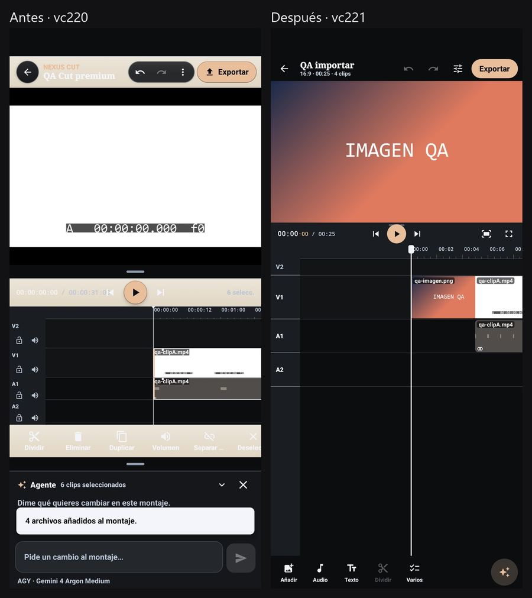
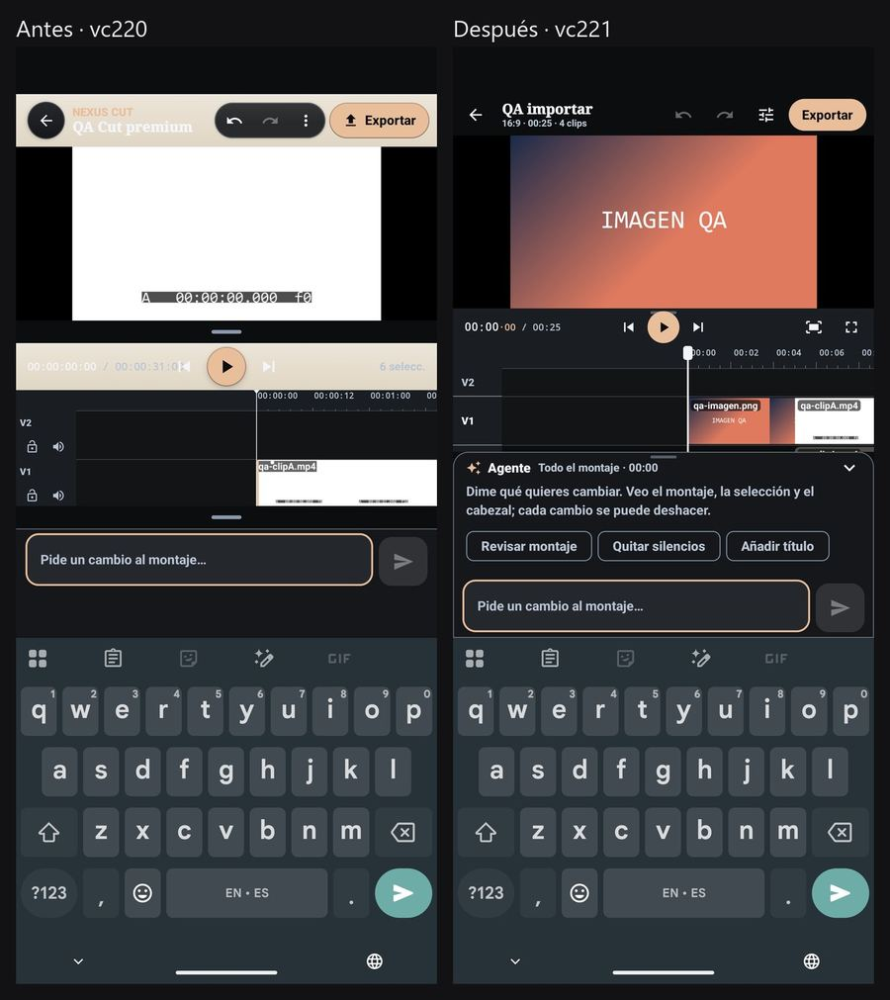
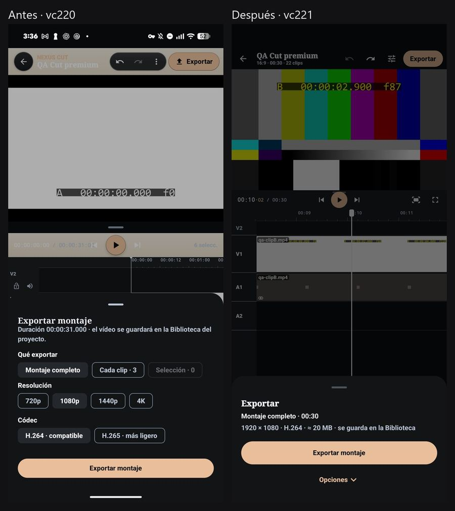
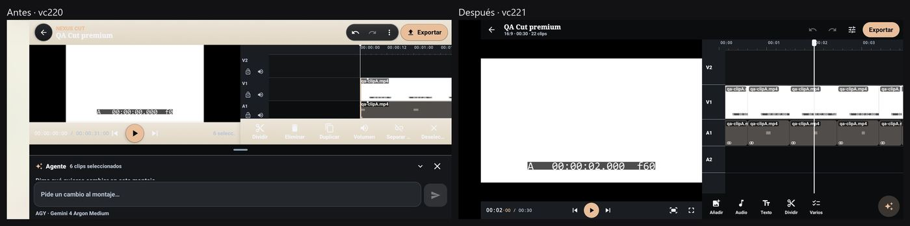

# Nexus Cut premium — auditoría, rediseño y validación (17/11/2026)

Rama `aki/cut-premium-20261117`, sobre `merge/v219-streaming-20261117` (`7feb18d2`, vc220, la última instalada y
verificada en el S25). vc221 / 1.9.185-agent-preview. Todas las pruebas de este informe se hicieron con la vc221l
(AWS CodeBuild `vidal-android-build:353caa9b-864c-4f1e-b984-82217ada349e`, APK SHA-256
`bd3628a5ec08dc33edf420150d224496903cc7a6dcf37548887e81219ebbbf7f`), que es la instalada en el Pixel. Se compiló a
las 09:17 del árbol de trabajo, 19 minutos antes de confirmarlo: su registro de origen dice `764bf6ed`, pero el código
es el de `1dbe3073` (los 4 archivos de código que cambian entre ambos son, en el zip enviado a CodeBuild, los de
`1dbe3073`; comprobado archivo a archivo). La última
compilación es la vc221m (CodeBuild `b7267e10-5834-466b-8c74-e41ad629ff83`, commit `527491ff`, APK SHA-256
`414fb0c671a50029e487db8a798af48c77ca71547db03495a1f4c7825f4b0ffc`): la vc221l más los nombres accesibles de las dos
asas (§4, «Después de vc221l»); está compilada, probada en JVM y firmada, y aún no instalada. Las ramas `feat/nexus-cut-20261111` y
`codex/cut-video-gestures-20261114` y la copia Android de Codex (`nexus-story-sync-android-20261111`) ya
están contenidas en esa base (comprobado con `git merge-base --is-ancestor`); su trabajo se conserva entero.

## 1. Punto de partida (vc220 en el Pixel 8 Pro, 448×997 dp)

Medidas de la jerarquía de UI y de capturas (`cut-premium-work/baseline/`):

| Vertical | antes |
|---|---|
| Previsualización | 303 dp (30 %) |
| Línea de tiempo | 210 dp (21 %) |
| **Contenido (imagen + montaje)** | **513 dp = 51 %** |
| Controles fijos (cabecera, asas, transporte, herramientas, agente fijo) | 432 dp |

Defectos principales: agente como panel permanente (21–32 % de la pantalla aun sin conversación), texto del
editor ilegible con el tema claro, reloj montado sobre «Fotograma anterior», regla `MM:SS:FF` ambigua, ajustes
escondidos en ⋮ y diálogos, exportar con todo abierto de golpe, sin modo inmersivo, horizontal sin sitio, sin
reordenación magnética ni marco de selección claro. Motor: la reproducción seguía en segundo plano, el cabezal
recomponía todo el editor a 30 Hz, fugas de `MediaMetadataRetriever`, exportación interrumpida que dejaba
«Exportando». Agente: cada `cut_edit` era un paso suelto, sin turnos revisables ni propuestas, catálogo truncado sin
avisar y sin silencios reales (solo heurística).

## 2. Dirección de diseño

La imagen y el montaje mandan; los controles aparecen según el contexto. Una sola cabecera de 44 dp (volver,
título con formato · duración · clips, deshacer/rehacer con lo que harán, ajustes, Exportar). Transporte de 40 dp
con reloj `00:06·12` (segundos·fotograma), fotograma anterior/siguiente, «Ver todo el montaje» y pantalla
completa. Debajo, la línea de tiempo ocupa todo lo que queda. Un muelle de iconos pequeños con etiqueta breve y
área táctil de 48 dp cambia con la selección. El agente es un botón flotante que abre un panel redimensionable y
desaparece cuando no se usa.

## 3. Qué cambia

**Espacio y composición**
- Reparto automático imagen/montaje según la proporción del proyecto: un 16:9 a todo el ancho sin franjas, el
  resto para la línea de tiempo; el asa entre ambos sigue permitiendo fijar otro reparto (y volver al automático).
- Las pistas crecen hasta 1,5× cuando sobra alto (miniaturas, ondas y asas más grandes) y nunca encogen. Las
  pistas vacías quedan en una fila baja de 30 dp (se ven y se tocan) y su alto pasa a las que tienen clips.
- Ajustes del montaje (formato, fotogramas por segundo, ripple, imán, calidad de previsualización, renombrar) y
  exportación en hojas inferiores con el estilo de Nexus; la exportación empieza con una línea resumen y
  «Exportar montaje», y los controles avanzados quedan en «Opciones».
- Modo inmersivo con fondo negro (también la franja de la cámara), barra de tiempo, reloj y reproducir.
- Horizontal: imagen a la izquierda, montaje y herramientas a la derecha; la franja del recorte de cámara es negra.
  Con el teclado abierto se recogen cabecera y línea de tiempo, la imagen sigue a la vista y el campo del agente
  conserva el foco (antes el teclado se cerraba al abrirse: no se podía escribir en horizontal). El asa del agente
  reparte el alto con la línea de tiempo también en horizontal.

**Línea de tiempo y gestos**
- Regla con marcas que caen en los segundos a 24/25/30/50/60 fps (antes a 25 fps salían «10f, 20f, 5f…»), sin
  deriva en montajes largos (paso exacto `1e6/fps`).
- Zoom inicial que muestra el montaje entero si es corto; «Ver todo el montaje» usa el lado más largo del cabezal y
  alterna con «Volver al zoom anterior».
- Selección con marco de acento y compañero de audio enlazado con contorno; arrastres al fotograma.
- Reordenación magnética: con pulsación larga el clip se «coge», un fantasma sigue al dedo y el bloque salta de hueco
  cuando su borde pasa la mitad del vecino, sin partir nunca un clip; píldora con destino y desplazamiento.
- Afinado del fotograma exacto al pararse el dedo durante el scrub, sin esperar a soltar.
- El cabezal se dibuja con el reloj del reproductor en cada fotograma de pantalla (120 Hz), aunque el estado se
  publique a 30 Hz.

**Háptica y movimiento** (`NexusHaptics`): eventos distintos para selección, coger (PICK_UP), encaje (SNAP),
límite (BOUNDARY), confirmación y error, con alternativas por nivel de API y separación mínima para no vibrar de
forma continua; respeta el ajuste del sistema. Animaciones de paneles con la escala de animación del sistema y
movimiento reducido.

**Agente dentro del editor**
- Misma `CutSession` que la interfaz: no hay copia paralela del proyecto. Cada turno del agente es un grupo de
  pasos: tarjeta con lo hecho, «Deshacer turno» / «Rehacer turno» (sin pisar cambios posteriores ajenos sin
  confirmarlo) y estado verificado (antes/después reales en `verified`).
- `dry_run` produce una propuesta con «Aplicar» / «Descartar»; las ediciones claras y reversibles se aplican.
- Nuevas habilidades: `audio.find_silences` (silencios medidos en el audio real, listos para
  `timeline.delete_ranges`), `cut_history`, `cut_revert`; contexto con selección, clips bajo el cabezal, revisión y
  qué desharía «Deshacer»; catálogo con `returned/truncated/hint`; argumentos desconocidos rechazados con sugerencia.
- Al importar el primer vídeo, el montaje adopta su cadencia (mismo paso de deshacer), aunque antes hubiera música o
  imágenes, que no tienen rejilla de fotogramas.
- Añadir al final de una pista (o a una pista vacía) ya no empuja ni parte lo que hay en las demás: con la música
  puesta, el vídeo entra a su lado. Insertar en medio sigue abriendo hueco en todas (sync lock).
- El selector de la Biblioteca respeta el orden en que se marcan los archivos y lo numera (1, 2, 3…): es el orden en
  que entran en el montaje. Desde el editor el botón dice «Añadir · n» (en el chat sigue siendo «Adjuntar»).
- La tarjeta del turno dice «Deshecho en parte» si se deshizo solo una parte desde la cabecera, y tras aplicar una
  propuesta el «Comprobado» recoge el antes/después del turno entero.

**Motor y fiabilidad**
- Sincronía: ningún elemento de audio dura más de lo que ocupa en el montaje (se descarta la cola que Media3
  descodifica de más). Media3 corta el AAC por paquetes completos y cada corte empujaba el resto de la pista (medido
  en el Pixel: +24 ms tras ocho cortes, creciendo). Queda un desfase fijo de menos de un paquete por clip.
- Reproducción pre-preparada: tras 450 ms sin tocar nada se prepara en pausa el reproductor del cabezal y
  Reproducir solo tiene que arrancarlo. Deja de valer con cualquier edición, scrub, cambio de superficie o LUT
  (nunca se reproduce uno preparado para otro estado) y se rehace cuando el editor vuelve a estar quieto; se libera
  al exportar, al girar y en segundo plano (nunca dos productores en la misma superficie). Prepararlo y liberarlo
  ocupan el hilo principal, así que con un dedo en el editor (arrastre, recorte, pellizco, scroll) se aplaza hasta
  que se levanta. No se usa en móviles de poca RAM. Registro con la etiqueta `NexusCutPreview` («pre-roll ready in …», «play (pre-rolled|cold) moving after …»).
- Pausa y liberación del reproductor al pasar a segundo plano; zoom guardado.
- Miniaturas: liberación de retrievers aunque el ámbito esté cancelado, conjuntos seguros entre hilos.
- Exportación interrumpida por el sistema: cancela el codificador, borra el temporal y lo dice.
- LUT con lectura acotada; extractor de ondas liberado aunque falle la apertura.

## 4. Validación

**Dispositivos.** Pixel 8 Pro físico (Android 17, 448×997 dp, 480 dpi, 120 Hz, háptica del sistema desactivada):
todas las pruebas de funcionamiento, con la variante instalada (`com.vidadomu.nexus.agent`, misma firma) y sus
datos conservados (copia y recuento de archivos antes y después de cada instalación). S25 Ultra: medidas leídas por
adb sin tocarlo; su distribución se simula en el Pixel con `wm size 1233x2673` a 480 dpi = 411×891 dp (mismo
tamaño en dp que el S25 a 560 dpi). No se ha instalado nada en el S25.

**Espacio útil (jerarquía de UI, mismo montaje de 4 pistas)**

| | vc220 | vc221 |
|---|---|---|
| Vertical, imagen + línea de tiempo | 513 dp (51 %) | 805 dp (81 %) |
| Vertical, imagen | 303 dp | 252 dp, 16:9 a todo el ancho sin franjas |
| Vertical, línea de tiempo | 210 dp | 553 dp |
| Vertical con el agente abierto | 513 dp (agente fijo) | 518 dp (52 %); cerrado, botón de 48 dp |
| Horizontal, alto de la imagen | 174 dp (39 %) | 364 dp (81 %) |
| Horizontal, línea de tiempo | 166 dp de alto | 399×346 dp |

**S25 Ultra simulado** (Pixel con `wm size 1233x2673` a 480 dpi = 411×891 dp, el tamaño en dp del S25; medido con vc221k, sin cambios de
distribución en vc221l):

| | vertical (411×891) | horizontal (891×411) |
|---|---|---|
| Imagen | 411×231 dp, 16:9 a todo el ancho | 443×327 dp |
| Línea de tiempo | 359×473 dp | 351×309 dp |
| Imagen + línea de tiempo | 704 dp de alto (79 %) | lado a lado, 327 dp de alto (80 %) |
| Con el agente abierto | línea de tiempo 226 dp (51 % de contenido) | línea de tiempo 163 dp, imagen intacta |
| Con el teclado | imagen 146 dp + línea de tiempo 90 dp + campo | imagen 134 dp + campo con foco |

Es una simulación: mismas dimensiones en dp, pero ni la densidad (560 dpi), ni el recorte de la cámara, ni las barras
del sistema son las del S25. En el S25 no se ha instalado nada.

**Arranque de la reproducción** (vc221k y vc221l, montaje «QA Cut premium», grabación de pantalla a 30 fps: del cambio del
botón al primer fotograma en movimiento): pre-preparado 0,13 s (4 medidas; registro de la app 115–161 ms, n = 7);
en frío, con el cabezal recién movido, 0,8–1,0 s (2 medidas); vc221i, sin pre-preparar, 1,57 s. Preparar el
reproductor cuesta 9–66 ms del hilo principal y 170–730 ms en segundo plano; liberarlo, 57–164 ms del hilo principal; desde vc221l
nunca con un dedo en el editor (antes podía coincidir con el arrastre siguiente a una edición). Comprobado en vc221l:
dividir y dejar el dedo 2,1 s en la línea de tiempo: nada se prepara ni se libera hasta 0,56 s después de levantarlo;
scrub, pellizco y reordenación con pulsación larga siguen funcionando con el observador de toques.
Regresión comprobada: scrub y Reproducir enseguida (arranca en frío, bien), dividir con el reproductor preparado
(se descarta y se rehace), deshacer, segundo plano y vuelta (se libera y se vuelve a preparar), exportar (se libera).

**Exportación final** (vc221l, 12,9 s para 30 s en 1080p; igual en vc221k): H.264 High 1920×1080 30 fps, 881 fotogramas, 30,17 s;
AAC LC 48 kHz estéreo, 30,20 s; descodificación completa sin errores; música presente en 18–30 s (media −29 dB).
Sincronía idéntica a vc221f: +10…+44 ms sin acumularse con 9 cortes (`cut-premium-work/export/SINCRONIA.md`).

**Instalación** (cada build en el Pixel): actualización `adb install -r -t` sobre la variante instalada, misma firma
(cert SHA-256 `8b75db0f…7127`), `firstInstallTime` conservado, copia de los datos antes y recuento después
(vc221l: 4195 archivos antes y después, 0 desaparecidos, archivos de Cut idénticos).

**Flujos comprobados en el Pixel** (capturas en `cut-premium-work/after/`, no versionadas): crear y reabrir montajes;
importar vídeo, imagen y audio (orden de marcado, fps del primer vídeo, la música no se mueve); seleccionar,
recortar, dividir, reordenar con fantasma; zoom con pellizco, «Ver todo», desplazamiento y scrub; reproducción;
ajustes y exportación en hojas; modo inmersivo; horizontal con y sin teclado; segundo plano y vuelta (mismo
montaje, cabezal y zoom); asa del agente en horizontal (línea de tiempo de 182 dp a 118 y 235 dp al arrastrarla);
agente con turnos locales sin modelo externo (`arm_edit`, `arm_script`): edición real
del montaje, propuesta, aplicar, «Comprobado», deshacer y rehacer el turno, deshacer parcial desde la cabecera;
`audio.find_silences` sobre audio real (19 tramos, contrastado con ffmpeg `silencedetect`).

**Exportación** (`cut-premium-work/export/SINCRONIA.md`): H.264 1920×1080 30 fps + AAC 48 kHz estéreo; sincronía
medida por destellos y pitidos de 1 kHz: +10…+44 ms sin acumularse con 9 cortes (origen +0…+18 ms).

**Pruebas automáticas** (CodeBuild, cada build; mismas cifras en vc221l y vc221m, contadas de los informes JUnit de
cada una: `build/vc221l/junit-recuento.txt`, `build/vc221m/junit-recuento.txt`): cut-core 133, agent-core 531
(4 omitidas, en vivo), app 72; 0 fallos. Nuevas: cálculo del tope de muestras de cada elemento de audio (`ItemFramesTest`), medidor de
volumen (`LoudnessMeterTest`), fps del primer vídeo e importación sin empujar (`DeviceCapabilitiesTest`), reordenación
por huecos (`LinkAndGroupTest`), turnos del agente (`CutSessionGroupsTest`, `BoundCutToolsTest`), silencios
(`AudioAnalysisTest`), reparto y pistas vacías (`CutInteractionStateTest`), regla (`CutRulerFormattingTest`) y
textos (`CutEditorTextTest`).

**GitHub Actions** (`build-apk.yml`, en cada push): compilación, APK, pruebas unitarias y compilación de las pruebas
de dispositivo, en verde en todos los pushes de la rama. El paso «Run presentation UI tests (offline fixtures)»
(emulador; `AssistantPresentationUiTest` y `ChatRichContentDeviceTest`, que no tocan Cut) pasó en dos de seis:

| Commit | Run | Paso de UI con emulador |
|---|---|---|
| `764bf6ed` | 44043579716 | falla 1 de 11 |
| `1dbe3073` | 44048242874 | pasa (11 de 11) |
| `96a074bf` | 44052299455 | falla 1 de 11 |
| `5dbc6f94` | 44052867770 | falla 1 de 11 |
| `00dfd523` | 44053856007 | falla 1 de 11 |
| `c80da997` | 44227657526 | pasa (11 de 11) |

En los cuatro fallos (registros leídos) falla la misma prueba y solo esa:
`ChatRichContentDeviceTest.penDoesNotDrawUntilLongPressAndAnnotationsAreSelected` (`ComposeTimeoutException` tras
5000 ms en la línea 113: el trazo del lápiz sobre el tablero de imágenes del chat no llega a guardarse a tiempo).
`96a074bf`, `5dbc6f94` y `00dfd523` solo cambian `CutFeedbackDeviceTest.kt` y documentación respecto de `1dbe3073`,
que pasó; `c80da997` (mismo código de la app que la vc221m) también pasa.
La misma prueba falla de forma intermitente en otras 7 ramas ajenas a esta desde el 14/11 (8 de los 21 runs que
llegaron a ese paso). Esta rama no toca el tablero del chat ni esa prueba, y el tablero no usa hápticos; lo único
compartido que cambia fuera de Cut es `NexusHaptics.kt` (eventos nuevos y limitador) y el fondo negro de
`MainActivity` en las rutas `cut/`. Con seis runs no se puede afirmar ni descartar que esta rama la haga fallar
más a menudo. No se ha corregido aquí: es una prueba de otra línea de trabajo.

**Prueba en dispositivo heredada** (`CutFeedbackDeviceTest`, opcional: `-PnexusFeedbackDeviceTests=true` y
`-e cutProjectId`): `previewGesturesAndAgentMinimizeDoNotEditTheMontage` buscaba etiquetas del editor anterior
(«Minimizar agente», «Mostrar agente del montaje», el asa con nombre) y habría fallado. Está actualizada al editor
nuevo: asa en la barra de transporte, agente oculto de entrada, comprobación sobre imagen + línea de tiempo y
reparto guardado restaurado al acabar; localiza las dos asas por su nombre. Actions la compila, no la ejecuta.

Primera ejecución en el Pixel (18/11 03:32, vc221l, APK de pruebas de `00dfd523` compilado en CodeBuild `751d3864…`
y firmado con la misma identidad): **falló, por la propia prueba y no por el editor**. Otro agente tenía abierta y
enfocada una pantalla virtual en el Pixel (scrcpy `--new-display`) y Android abrió allí la actividad; la prueba
encontró los nodos del editor, pero la captura y los toques inyectados fueron a la pantalla integrada, donde estaba
el launcher, y la guarda de primer plano la detuvo tras el primer toque. La causa se leyó en el registro de eventos
del sistema en ese momento y no se guardó el volcado: lo archivado es el fallo de la guarda (`report.json`) y una
nota con las líneas leídas (`devtest/20261118-033136-…/causa-registro-sistema.txt`). La app y sus datos quedaron
intactos (4206 archivos antes y 4207 después, 0 desaparecidos; archivos de Cut y reparto guardado sin cambios;
paquete de pruebas desinstalado).
Corregido en `527491ff` y `10d8caad`: la prueba pide la pantalla integrada y falla si no la obtiene, y un gesto
abandonado a medias levanta los dedos (`ACTION_CANCEL`). Verificación independiente de solo lectura de
`00dfd523..527491ff`: 9 puntos correctos, dos de ellos con reservas: la cancelación del pellizco con dos dedos
pulsados, que es el arreglo de `10d8caad`, y que, cuando la pantalla no es la integrada, la tarea de `MainActivity`
sigue abierta un momento mientras se cierra. Que la prueba pase entera solo lo aclara una ejecución en dispositivo.
**Sigue sin haber pasado en un dispositivo**: el Pixel está en uso por ese otro agente y no
se toca mientras lo esté.

**Después de vc221l** (`2ce90114`, compilado como vc221m): las dos asas recuperan su nombre accesible («Tamaño de la
previsualización y la línea de tiempo», «Tamaño del panel del agente»), el observador de toques del editor depende
del ViewModel (`pointerInput(vm)`) y el comentario de `PreviewController.setTouching` dice lo que hace. Mismas pruebas
JVM en verde; APK firmada con la identidad instalada (cert SHA-256 `8b75db0f…7127`, firmas v2 y v3, 16 KiB, 6/6
`.so` idénticas a vc220); respecto de la vc221l solo cambian 5 `.dex` y la firma. **No instalada todavía** por el
mismo motivo: nada de este informe se ha repetido con la vc221m.

**Qué comprobar de la háptica en el S25** (pendiente de Vidal; no se ha sentido en ningún dispositivo). Con la
vibración al tocar del sistema y la «Respuesta háptica» de Nexus activadas, cada fila debe notarse distinta de las
demás, salvo las tres de confirmación, que comparten el mismo efecto del sistema (`CONFIRM`):

| Gesto en el editor | Evento (`NexusHaptics`) | Qué debe notarse |
|---|---|---|
| Tocar un clip, Reproducir, abrir Ajustes, Exportar o el agente | SELECTION | un toque corto y ligero |
| Pulsación larga sobre un clip para moverlo | PICK_UP | un golpe más marcado al «cogerlo» |
| Empezar a recortar un borde o un fundido | GESTURE_START | inicio de arrastre |
| Con el imán activado, un borde o un clip llega al borde de otro clip, al cabezal o al inicio del montaje | SNAP | un solo toque al entrar en el imán, no mientras sigue pegado |
| Arrastre que el montaje no admite (recorte sin más material, clip contra su vecino), zoom en su tope, cabezal que llega al inicio o al final del montaje al desplazar o lanzar | BOUNDARY | un clic seco, como mucho cada 0,25 s |
| El cabezal cruza un corte al desplazar (con o sin imán); fotograma anterior o siguiente | GESTURE_TICK | un tic por corte o por fotograma (como mucho cada 70 ms), nunca un zumbido |
| Soltar un recorte o un movimiento | GESTURE_END | cierre suave |
| Dividir, «Inicio aquí», «Final aquí», Duplicar, Separar, Eliminar, Rehacer, aplicar una propuesta, exportación terminada | CONFIRMATION | confirmación |
| Deshacer; «Deshacer turno» del agente | CANCEL_CONFIRMED | confirmación (el mismo efecto) |
| Bloquear o silenciar una pista, «Varios», ripple e imán en Ajustes | TOGGLE_DECISIVE | confirmación (el mismo efecto) |
| Una acción que falla; exportación con error | ERROR | rechazo, distinto de la confirmación |

Con la vibración al tocar del sistema desactivada (así está el Pixel) o con «Respuesta háptica» apagada en los ajustes
de Nexus no debe vibrar nada. Tabla contrastada con el código por un verificador independiente de solo lectura y
corregida con sus observaciones; el modelo admite marcadores como destino del imán, pero el editor no tiene aún forma
de crearlos.

## 5. Límites conocidos

- La exportación conserva la cadencia del material de origen; los fps del montaje son la rejilla de edición. Con
  material mixto la salida puede tener cadencia variable.
- Háptica: el lenguaje está implementado y revisado en código, pero no se ha sentido en ningún dispositivo. El Pixel
  tiene la háptica del sistema desactivada (se respeta y no se ha cambiado) y en el S25 no se ha probado. La lista
  de qué debe notarse en cada gesto está al final de §4.
- Agente con un modelo real: no probado para no consumir cuota de proveedores. Los turnos, propuestas, deshacer y
  verificación se han comprobado con turnos locales (`CutChatQa`, solo DEBUG) que pasan por las mismas herramientas.
  La prueba real está preparada (dos turnos con el modelo del Pixel, sin proveedores de pago por uso) y espera el
  «Sí» de Vidal.
- Durante el primer segundo de reproducción la cadencia aún es irregular (algún tirón de 0,3–0,4 s), también en
  frío: viene de cómo arranca el `CompositionPlayer` de Media3 y queda pendiente.
- La distribución del S25 está simulada en el Pixel (ver arriba); falta verla en el propio S25.
- Un corte que no cae en la rejilla del material deja un fotograma muy corto (4,7 ms en 7,171 s del montaje de prueba;
  ffmpeg avisa de «dts no monótono» al reempaquetar). Sale igual en todas las exportaciones de esta rama (vc221c,
  vc221f, vc221k, vc221l); no se ha comparado con vc220. Los reproductores lo muestran bien.
- Verificación independiente (solo lectura) de `764bf6ed`: 10 puntos correctos y 3 de exactitud del informe, ya
  corregidos; de sus hallazgos se arreglaron en vc221l la preparación en mitad de un gesto, el fallo pasajero que
  bloqueaba un cabezal y el asa del agente en horizontal. Hallazgos bajos sin corregir: con el agente abierto en horizontal, cualquier
  teclado (no solo el del chat) recoge cabecera y línea de tiempo; el diseño horizontal se elige por orientación,
  no por ancho (pantalla dividida); el reproductor en espera mantiene sus decodificadores mientras el editor está
  quieto y solo los suelta al exportar, girar o salir.
- Segunda verificación independiente (solo lectura) de `764bf6ed..1dbe3073`: 7 puntos correctos, ninguno incorrecto.
  De sus hallazgos bajos, corregidos en vc221m el comentario de `setTouching` y la clave del observador de toques.
  Sin corregir: con un dedo puesto aún puede liberarse el reproductor en espera si falla, cambia la superficie o
  llega un LUT; el asa del agente en horizontal tiene una pequeña zona muerta en los extremos y su reparto por
  defecto es 55 % (antes 55,6 %).
- Tercera, cuarta y quinta verificación independiente (solo lectura): la prueba de dispositivo (`00dfd523..527491ff`,
  9 de 9 con dos reservas, ver §4), la exactitud de este informe frente a sus evidencias (5 precisiones, corregidas
  en `e2eae553`) y esas correcciones (7 de 7).
- En la vc221l instalada las dos asas de reparto no tienen nombre de accesibilidad (conservan sus acciones, pero un
  lector de pantalla puede no detenerse en ellas). Corregido en vc221m. No se ha probado con TalkBack.
- Montajes de prueba creados en el proyecto «General» del Pixel: «QA Cut premium», «QA importar» y «QA orden», más
  cinco exportaciones «QA_Cut_premium-…» en la Biblioteca. No se ha borrado nada.

## 6. Capturas

Antes (vc220) y después (vc221), Pixel 8 Pro físico, mismo material de prueba:

