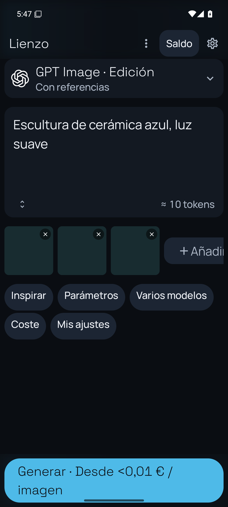
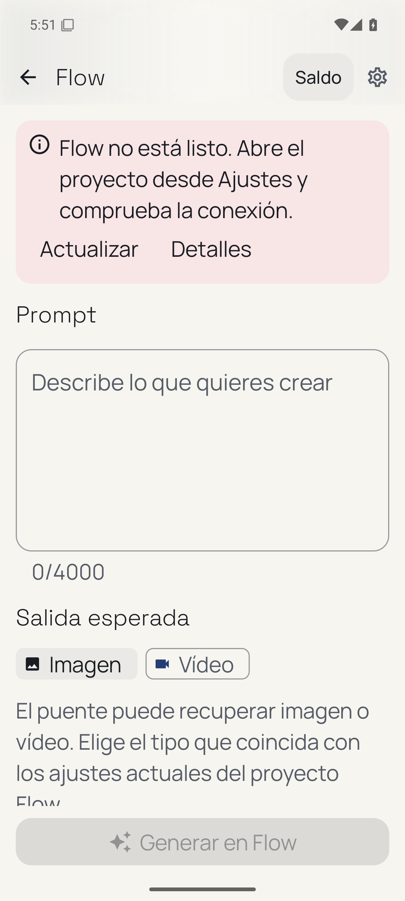
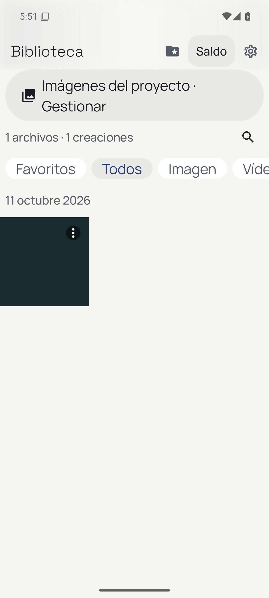
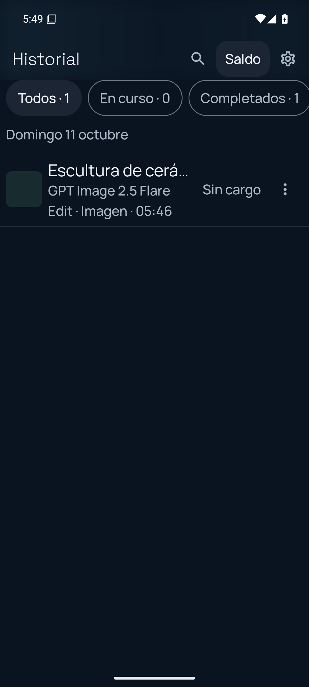

# Adaptación de presentación sobre Studio 1.8.9

Base publicada: `f3083e14c612cb74bc1352230bd6d77438d47e70`, rama `codex/agent-queue-budget-189`. S25 comprobado con 1.8.9-agent-preview/vc33. Rama de esta adaptación: `codex/studio-accessibility-20261011`; worktree separado `nexus-studio-accessibility/NEXUS`.

La entrega anterior en `codex/ui-minimal-20261009` se conserva como referencia, con QA final parcial. No se trasplanta la navegación antigua ni el selector de tres modos: la versión vigente utiliza Studio y modo Agente. Se conservan las capacidades de documentos, recientes, Biblioteca, recuperación y presupuesto añadidas después.

## Inventario de las funciones afectadas

| Función | Ubicación vigente | Ubicación tras adaptación | Toques | Verificación |
|---|---|---|---|---|
| Saldo y gasto, proveedores, hora y actualización | Chip de cabecera → hoja | Mismos destinos; cifras legibles y detalles de errores | 1–2 | BalanceSheetUiTest y prueba del chip a escala 1,5; sin consulta real a proveedores |
| Detalles de un saldo no interpretable | Valor sin formato en hoja | Aviso humano → Detalles con valor original | 2 | BalancePresentationTest y expansión de InlineNotice |
| Prompt, parámetros, inspiración, varios modelos y presets | Lienzo y su fila de herramientas | Mismos destinos Studio | 1–2 | CanvasMinimalUiTest, capturas y callbacks de las cinco herramientas a escala 1,3/1,5 |
| Generar y precio estimado | CTA del Lienzo | Mismo CTA; etiqueta adaptable | 1 | Callback simulado y texto completo, sin generación ni cobro |
| Biblioteca: abrir, favorito, prompt, compartir, ocultar y deshacer | Miniatura, pulsación larga o opciones → hoja | Mismos callbacks y persistencia | 1–2 | LibraryMinimalUiTest y contratos de exportación; callbacks restantes conservados en diff, sin compartir archivos del usuario |
| Proyecto y recientes | Selector de archivos compartido | Mismos destinos y selección | 1–2 | ProjectMediaPickerTest con archivos temporales de QA |
| Consumo y límites del agente | Ajustes del agente → consumo | Mismos límites en USD; resumen en moneda elegida | 1–2 desde Ajustes | Revisión de callbacks y formateador existente; edición real del presupuesto no probada |
| Recuperación de trabajos y consulta de estado | Herramientas nativas y menú de seguimiento | Sin cambios de comportamiento | Igual | Contratos conservados; no se invoca a proveedores |
| Navegación y ajustes | Barra y deslizamiento de la versión actual | Sin cambios de rutas | Igual | AgentNavigationTest, SettingsMinimalUiTest y contratos de cuatro destinos |

## Alcance y validación

Sólo presentación y tests de presentación. No se cambian generación, proveedores, cobro, colas, persistencia ni herramientas del agente. Los errores técnicos permanecen disponibles en Detalles. No se ejecutan operaciones de pago ni se instala una APK en el S25 por compilar.

### Cambios y decisiones

- La barra Studio conserva sus efectos y acciones. Con escala de fuente desde 1,3 usa 56 dp de altura y títulos `titleMedium`; se sigue aplicando íntegra la escala del sistema. El chip admite dos líneas, tiene objetivo táctil de 48 dp y anuncia el saldo completo.
- Las cinco herramientas del Lienzo pasan a varias filas con letra grande. El CTA admite dos líneas para mantener visible el precio. Las condiciones de envío, bloqueos, preparación y callbacks permanecen iguales.
- El proyecto anuncia su nombre completo, escena y referencias. Con letra grande se oculta la segunda línea de la cabecera; esa información sigue en la semántica accesible y en Proyecto. Se conservan las elipsis deliberadas de nombres largos y resúmenes del catálogo.
- Los saldos agrupados aceptan ambos separadores decimales; un valor desconocido no se convierte en cero ni expone una excepción. El resumen de consumo usa la moneda elegida mediante el formateador vigente; los límites editables continúan explícitamente en USD y usan la misma validación/persistencia.
- Los errores del seguimiento se presentan como aviso humano con diagnóstico desplegable. `InlineNotice` anuncia cambios mediante región accesible y utiliza los colores de error del tema en sus acciones. Se añaden mensajes de presentación para límites de consumo y CountTokens.
- Las hojas de archivos usan insets del sistema, tokens y nombres completos accesibles. Se conservan favoritos, ocultación, recuperación, adjuntos, exportación y menú de acciones.

### Validación de esta fuente

| Comprobación | Resultado | Evidencia y límites |
|---|---|---|
| Compilación AgentPreview en ASUS | PASS | Un worker, sin paralelismo, prioridad baja; copia privada con manifiesto SHA-256 comprobado tras compilar |
| Compilación OfflineQa y tests unitarios | PASS: 382 | 112 de agent-core y 270 de app; cero fallos o casos omitidos |
| Regresión de interacción en emulador | PASS: 15 | Navegación, Lienzo, saldo, catálogo, Biblioteca, asistente, archivos, ajustes y presentación; 124,341 s |
| Matriz de capturas después | PASS: 144 | Ocho pantallas × seis temas actuales × tres escalas (1,0/1,3/1,5), Pixel 6a de 6,1 pulgadas, API 35; datos sintéticos |
| Revisión visual | Parcial | Se revisaron ejemplos de las ocho pantallas con escala 1,5 y Lienzo con 1,3; la generación automática de 144 capturas no equivale a inspección manual completa |
| Capturas antes de Studio 1.8.9 | NO PROBADO | Las capturas históricas de vc28 no se presentan como antes de esta fuente |
| Pruebas en Pixel/S25 y TalkBack manual | NO PROBADO | Ambos dispositivos estaban bloqueados; no se ha instalado esta adaptación en ellos |
| Generaciones, proveedores y cobros reales | NO EJECUTADO | Fuera del alcance; ninguna operación de pago |

Se actualizaron siete tests unitarios antiguos que esperaban cinco destinos o autocompletado sin `@`, además de dos selectores de UI desfasados. Los nuevos tests verifican todos los caracteres dibujados del precio, ausencia de elipsis y límites de cada línea con tolerancia de un píxel por redondeo. No se eliminan las comprobaciones de cursor, selección, texto desconocido o direcciones de correo del autocompletado.

El emulador anterior produjo bloqueos de SystemUI: sus capturas se rechazaron. Se utilizó un AVD nuevo y vacío con GPU host, dos núcleos y Vulkan desactivado; Chrome, Maps, Messaging, Search y GMS se desactivaron temporalmente durante el QA para evitar bloqueos de primer arranque. Los cinco paquetes se restauraron a `enabled`, se dejó `font_scale=1.0` y se cerró el emulador al terminar. Las capturas sólo se aceptan cuando el paquete activo es el de QA. El AVD anterior y los datos de los dispositivos se conservan.

### Artefacto de revisión

APK `com.vidadomu.nexus.agent`, `1.8.9-agent-preview`, versionCode 33; conserva la identidad de la base y **no constituye una nueva versión instalada**. La copia de revisión se firmó con la firma existente, certificado SHA-256 `8b75db0fe0849019990f0d9d6426b95d85414f0585acac78a06c484b91cd7127`, y se verificó con apksigner.

SHA-256 de `nexus-studio-accessibility-vc33-review.apk`: `a197d3ccb30e3e9cf302cbef0bc79b5db7edd58cac8c932d1dfd4545a50fd1b0`.

### Instalación posterior autorizada

Tras la petición explícita de instalar, se comprobó que el S25 seguía en vc33 y que el certificado de su APK coincidía. Se conservó una copia privada de la APK previa y se instaló con `adb install -r`, sin desinstalar ni borrar datos. Resultado `Success`; el SHA-256 de la APK instalada coincide con el artefacto de revisión anterior. Se mantiene `1.8.9-agent-preview`/vc33. La actividad principal respondió `Status: ok` y el proceso siguió activo. Esta comprobación de instalación y arranque no sustituye la matriz física ni el QA manual de TalkBack pendientes. Las filas anteriores describen la validación previa a la instalación.

La APK y los logs completos permanecen en los outputs privados del encargo; no se publican claves, firmas, cachés ni datos del usuario. Esta adaptación no certifica el cumplimiento total del antiguo prompt maestro: quedan pendientes la inspección física con TalkBack, un antes/después sobre la misma base y una verificación exhaustiva de todos los elementos del inventario histórico.

### Capturas de ejemplo después

Todas contienen datos sintéticos de la variante aislada `.uiqa`, escala 1,5. No muestran generaciones ni saldos de la cuenta real.

